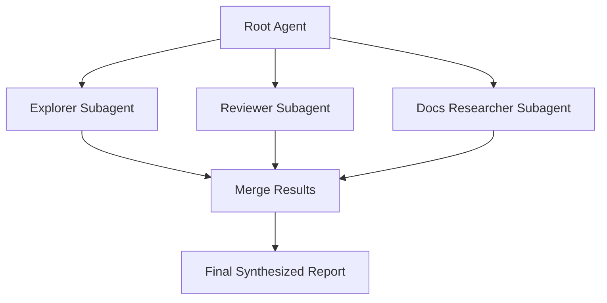

**TL;DR**

- Codex subagents trade higher token usage for focused context and parallel execution, ideal for read-heavy work like codebase exploration and PR review [1].
- The Responses API multi-agent beta defaults to three concurrent subagents with no fixed upper bound, and prefers WebSocket over HTTP for tool-heavy runs [2].
- Parallel subagents win on independent bounded tasks; keep a single agent when each step depends on the previous one [2].

A single Codex agent grinding through a large pull request will eventually lose the plot. Its context fills with file dumps and half-analyzed edge cases. The quality of every later decision degrades on cue. The fix is not a bigger prompt; it is delegation. Subagents split one task across several focused workers that run in parallel and hand back a consolidated result, so the main agent stays sharp for requirements and judgment [1].

## What Codex Subagents Actually Save You

OpenAI Codex can spawn specialized agents in parallel and collect their results in a single response; that result surfaces across the ChatGPT desktop app, the Codex CLI, and the IDE extension [1]. Each subagent runs its own model and tool work, so the workflow consumes more tokens than a comparable single-agent run [1]. You are paying for focus (and wall-clock speed), not for free compute.

That focus is the real payoff: focus is what keeps the orchestrating agent sharp. Chroma's research across 18 LLMs showed that performance degrades non-uniformly as input length grows, even under minimal controlled conditions. Context length alone changes how a model behaves [5]. Subagents counter this by moving noisy intermediate output (file dumps, dead ends) off the main thread; the orchestrator keeps its window clean (and spends its attention on requirements and decisions) [1][5].

> [!TIP]
> Think of subagents this way: context isolation first, parallelism second. The win is a main agent whose window stays clean even before you account for any speedup.

## Triggering Parallel Work in the CLI and ChatGPT Work

Delegation starts with an explicit prompt: tell Codex to split the task (and assign each piece to a worker). Codex spawns subagents only when you ask, or when AGENTS.md or skill instructions request delegation [1]. It dispatches work to built-in agents like default, worker, and explorer [1]. You will see the resulting activity in whichever surface you launched from: the desktop app, the CLI, or the IDE extension [1]. How should you frame that first split?

The mental model is simple: the root agent is the coordinator; subagents are specialists that report back. You do not hand the whole problem to one helper; you carve off bounded slices that can each finish on their own [1].

## Configuring Custom Agents with TOML Files

Custom agents live in standalone TOML files. Use ~/.codex/agents/ for personal setup, or .codex/agents/ for project-scoped teams [1]. Every file must define name, description, and developer_instructions. Optional fields let you pin a model, set model_reasoning_effort, restrict sandbox_mode, attach mcp_servers, and configure skills [1].

```toml
name = "pr_reviewer"
description = "Reviews pull requests for correctness and security issues"
developer_instructions = "You review code changes. Report each finding with file and line."
model = "gpt-6.1-sol"
model_reasoning_effort = "high"
sandbox_mode = "read-only"
```

Global behavior is tuned in config.toml under the [agents] table: you can enable or disable subagents, cap concurrency with max_concurrent_threads_per_session, and set defaults: agents.default_subagent_model and agents.default_subagent_reasoning_effort [1]. When you leave the thread-per-session value unset, Codex picks its own default [1].

Codex custom agents are TOML files. Claude Code subagents are different: they use Markdown files with YAML frontmatter and no TOML at all [3].

## Going Deeper with the Responses API Multi-Agent Beta

For programmatic orchestration, the Responses API exposes multi-agent as a beta feature on GPT-6.1 Sol and all GPT-5.6 models, and you enable it with multi_agent.enabled [2]. The API ships six hosted collaboration actions: spawn_agent, send_message, followup_task, wait_agent, interrupt_agent, and list_agents [2].

The default max_concurrent_subagents is 3, with no fixed upper bound, and there is also no hard limit on tree depth or the total number of subagents created during a run [2]. Agents are addressed by hierarchical paths such as /root/researcher [2]. What does that mean for your orchestration code?

| Orchestration action | What it does |
| --- | --- |
| spawn_agent | Create a child subagent to run a task |
| send_message | Deliver a message to an existing subagent |
| followup_task | Assign more work to an existing non-root agent and start or resume its turn |
| wait_agent | Wait for an update in the calling agent's mailbox |
| interrupt_agent | Interrupt another agent's active turn without deleting its context |
| list_agents | Enumerate the current agent tree |

> [!IMPORTANT]
> Use WebSocket rather than HTTP for tool-heavy or long-running multi-agent work, because it reduces coordination delays and avoids extra request round trips [2].

## Setting Concurrency Guardrails Without Over-Engineering

There is no fixed ceiling on concurrency: the Responses API default of three concurrent subagents is still the sensible place to start [2]. In the CLI you can impose a global cap through max_concurrent_threads_per_session [1]. Because there is no tree-depth limit, a runaway spawn can branch wide and deep [2]. A deliberate cap protects your token budget. So how do you pick a cap?

OpenAI recommends parallel subagents for read-heavy tasks first: exploration, tests, triage, and summarization, and it urges caution with write-heavy workflows, which can create conflicts and increase coordination overhead [1]. When many workers touch the same files, you risk racing writes (hard to reconcile afterward). As a practical rule, we keep file writes on the coordinator so only one agent mutates state at a time.


Cap concurrency at the Responses API default of three and reserve parallel subagents for read-heavy work. Write-heavy parallelism invites edit conflicts [1][2].


## Merging Results Without Losing the Signal

The root agent owns final synthesis, and nobody else gets to merge. A clean pattern is to assign one agent per category, wait for every agent to finish, then summarize the grouped findings into a single answer [1][2].

Handle duplicates and conflicts explicitly. A good pattern is to ask each agent to return structured output: one finding per line, with a file and line reference. Then reconcile duplicate or conflicting findings into a prioritized review [2]. When two workers genuinely disagree, surface both readings so the human can decide rather than silently picking a side. How do you keep the merged result trustworthy?

This layered structure keeps the final answer tidy. One coordinator delegates, several workers investigate, and one deliberate merge turns three focused reports into a single clean recommendation.



## How Claude Code Approaches the Same Problem

Claude Code offers a comparable model; each subagent runs in its own context window with a custom system prompt, specific tool access, and independent permissions [3]. It ships built-in subagents like Explore and Plan; custom definitions add several extras: tool allowlists, permission modes, PreToolUse hooks, scoped MCP servers, and persistent memory [3].

One concrete difference: budgeting discipline. Claude Code warns when combined subagent descriptions exceed 15,000 tokens, and it recommends trimming descriptions and moving detail into system prompts [3]. Codex's docs don't surface an equivalent description-token warning. That token-conscious habit is worth importing into your own Codex agent files [1][3]. Which habit is worth importing first?

Teams not tied to OpenAI have other options. LangGraph models multi-agent workflows as explicit graphs, with agents as nodes and connections as edges. Autogen uses a conversation model, and CrewAI offers a higher-level team abstraction [7]. Anthropic's Managed Agents infrastructure decouples the brain from the hands and the session log, so failures recover independently [6].

## Choosing Between Parallel Subagents and a Single Agent

Parallel subagents earn their cost when tasks are independent and bounded, when separate context improves focus, and when fan-out shortens wall-clock time (the whole point of delegating) [1][2]. A PR review that splits codebase mapping, security analysis, and API verification across three workers can finish faster than one agent doing all three in sequence [1].

Prefer a single agent when each step depends on the previous one, when the task is small and short, when workers would contend over mutable state, or when you need a fixed deterministic graph [2]. Anthropic's broader guidance is blunt. Start with the simplest solution that works, and add complexity only when it buys better task performance. Agentic systems trade latency and cost for capability [4]. So when does fan-out actually pay off?

| Scenario | Use parallel subagents | Use a single agent |
| --- | --- | --- |
| Independent bounded tasks | Yes, fan out and merge | No |
| Each step depends on previous step | No, ordering breaks | Yes |
| Workers contend over mutable state | No, race conditions | Yes |
| Small, short task | No, overhead exceeds gain | Yes |
| Read-heavy exploration or triage | Yes, context stays clean | Only if tiny |

## A Real Parallel PR Review in Practice

A concrete Codex pattern runs three custom agents in parallel for a single PR. The first, pr_explorer, maps the changed codebase in read-only mode. The second, reviewer, checks correctness and security. The third, docs_researcher, verifies API behavior against live references using an MCP server [1]. You tune each one with model selection: use gpt-6-luna for exploration and gpt-6.1-sol for careful review, plus reasoning-effort and sandbox restrictions per agent [1].

The value of this setup is isolation: each worker inspects a bounded slice, and the root agent merges three clean reports instead of one bloated transcript [1][2]. The practical payoff is easier review: because each finding already carries a file and line, the merge can become a short, skimmable set of items rather than a transcript you have to re-read.

## Practical Takeaways

1. Split your next review across three read-only subagents: explore, review, verify. Merge the reports centrally to keep the main context clean [1].
2. Pin model and model_reasoning_effort per custom agent in TOML. Use gpt-6-luna for exploration and gpt-6.1-sol for careful review [1].
3. Cap concurrency at the Responses API default of three and route tool-heavy multi-agent workloads over WebSocket to reduce coordination latency [2].
4. Reserve parallel subagents for independent, read-heavy tasks. Fall back to a single agent when steps are ordered or workers share mutable state [2].

## Conclusion

Subagents change the economics of delegation: they let a single agent buy back its own focus. The real trade-off is that every parallel fan-out spends extra tokens on coordination, so treat concurrency as a budget, not a dial. A useful question to keep in mind is whether your merge plan is as deliberate as your fan-out plan (most teams answer no on a first draft). Start small: three read-only subagents for your next review, merged centrally, is a low-risk way to begin.

*This post may contain affiliate links. We may earn a small commission if you sign up through our links, at no extra cost to you.*

## Frequently Asked Questions

### How many subagents can Codex run in parallel?

The Responses API defaults to three concurrent subagents [2].

### Do Codex subagents cost more than a single agent?

Yes. Each subagent performs its own model and tool work, so the workflow consumes more tokens than a comparable single-agent run [1]. You trade that cost for focused context and parallel execution.

### Should I use parallel subagents or a single agent?

Use parallel subagents for independent, read-heavy, bounded tasks where fan-out shortens wall-clock time. Prefer a single agent when steps are ordered, the task is small, or workers would contend over mutable state [2]. See the comparison table in "Choosing Between Parallel Subagents and a Single Agent".

### How does Claude Code differ from Codex subagents?

Claude Code subagents are Markdown files with YAML frontmatter, each with its own context window and permissions [3]. It also warns when combined descriptions exceed 15,000 tokens, a budget discipline Codex's docs don't describe. That warning is worth treating as guidance for your own Codex files too.

### What transport should I use for API multi-agent workflows?

Prefer WebSocket over HTTP for tool-heavy or long-running multi-agent runs. WebSocket is likely to provide lower latency and better end-to-end performance than HTTP, and it reduces coordination delays and avoids extra request round trips [2]. HTTP may still be sufficient for workflows with few function calls or mostly hosted tools.

---

## Sources

| # | Publisher | Title | URL | Date | Type |
| --- | --- | --- | --- | --- | --- |
| 1 | OpenAI | "Subagents | ChatGPT Learn (Codex Documentation)" | https://developers.openai.com/codex/subagents | 2026-10-09 | Technical |
| 2 | OpenAI | "Multi-agent | OpenAI API (Responses API Guide)" | https://developers.openai.com/api/docs/guides/responses-multi-agent | 2026-10-09 | Technical |
| 3 | Anthropic | "Create custom subagents | Claude Code Docs" | https://docs.anthropic.com/en/docs/claude-code/sub-agents | 2026-10-09 | Technical |
| 4 | Anthropic | "Building effective agents" | https://www.anthropic.com/engineering/building-effective-agents | 2024-12-19 | Blog |
| 5 | Chroma | "Context Rot: How Increasing Input Tokens Impacts LLM Performance" | https://research.trychroma.com/context-rot | 2025 | Paper |
| 6 | Anthropic | "Scaling Managed Agents: Decoupling the brain from the hands" | https://www.anthropic.com/engineering/managed-agents | 2026-04-08 | Blog |
| 7 | LangChain | "LangGraph: Multi-Agent Workflows" | https://blog.langchain.dev/langgraph-multi-agent-workflows/ | 2024 | Blog |

## Image Credits

- **Cover photo**: Image generated with gpt-5.4-image-2 (Agents' Codex AI illustration)
