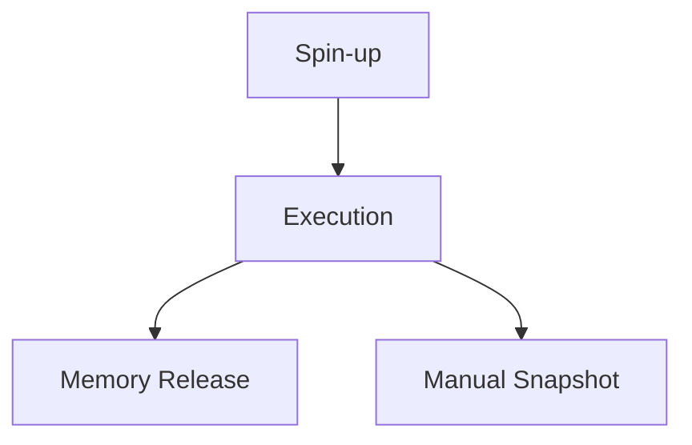

**TL;DR**

- Docker Sandboxes are MicroVMs with their own kernel, not containers, despite the Docker name.
- Brig keeps its credential file on memory-backed tmpfs, so the secret never reaches host disk while an agent runs.
- Clawk releases idle VM memory after 30 minutes, making disposable agents cheap enough to run per-ticket.

A coding agent that can edit files, push commits, and execute shell commands is a privilege escalation waiting to happen. Hand it your host credentials and a prompt injection turns into a key leak. The fix is not a bigger LLM, it is a boundary. Three architectures now compete for that boundary: Docker Sandboxes, Brig's MicroVM, and host-based sandboxes that scope the agent through the host operating system's own entitlements. Most teams pick wrong because they treat isolation strength as a single knob, which it is not. The real question is whether any shared kernel is acceptable, and the answer decides which path actually gives your agent a genuine separate kernel [1][2][3].

## Why Shared-Kernel Isolation Fails Coding Agents

Containers solved packaging, not security — a Docker container shares the host kernel, so a kernel-level bug inside the container can reach the host directly. For a coding agent that interoperates with arbitrary tool output, that shared plane is where the risk concentrates.

The failure mode is concrete: the agent reads a file; the file contains hostile instructions; and now you have execution of attacker-controlled text inside a process that shares your kernel. Even with seccomp and namespace filtering, isolation stays a filter over one kernel rather than a second kernel.

Host-based sandboxes share the same flaw from a different angle: macOS seatbelt profiles and entitlement scoping can restrict files, network, and process spawning, but the agent still runs as a normal process on the host kernel. A bug in enforcement is a direct path to your home directory, and no number of entitlements changes the fact that the attack surface includes your kernel.

That single fact pushed the field toward MicroVMs — a MicroVM gives the guest its own kernel, so a crash or compromise stays inside the boundary; the guest cannot reach anything you did not map in, because no shared kernel carries the pointer. The three approaches below differ in how many layers they keep between the agent and your host.

> [!NOTE]
> The Docker name misleads here — Docker Sandboxes are MicroVM environments with their own kernel, and the product page is explicit that they are not containers [1].

## Three Isolation Architectures, Side by Side

Adoption tells part of the story before you read a single doc — Brig sits at 232 GitHub stars, while Clawk has reached 1030 [4][5]. Raw stars say little about the security model underneath. A popular project can still ship a weak one and a niche one can be airtight.

Docker Sandboxes wrap a MicroVM in a managed workflow. Brig runs the agent inside Apple's Virtualization.framework on macOS, where the guest gets a dedicated kernel with no container shim between it and the hypervisor. On Linux, Brig drives nerdctl and hands the container to the urunc shim, so the path differs there [2]. Clawk uses the same Virtualization.framework to spin up disposable Linux VMs: root access inside the guest, host files and keys kept outside [3].

The telling difference is what each treats as its trust boundary: Brig and Clawk lean on a hypervisor as the hard line. Docker Sandboxes starts from the same MicroVM base but keeps the local product free and standalone, while the optional Cloud Sandboxes and the organization-level policy controls come as add-ons on top [1].

| Dimension | Docker Sandboxes | Brig | Clawk |
| --- | --- | --- | --- |
| Isolation base | MicroVM (own kernel) | MicroVM (Virtualization.framework / urunc) | MicroVM (Virtualization.framework) |
| Host platforms | Native VMM on macOS, Windows, Linux | macOS 15+ (Apple silicon), Linux x86-64/arm64 | macOS 14+ (Apple silicon) |
| Linux support | Native | nerdctl + urunc | Experimental (Firecracker) |
| Credential boundary | Policy-governed | Memory-backed tmpfs, never host disk | Host keys isolated outside the guest, SSH agent forwarded for git |
| Network control | Managed policy | Egress policy (optional; unrestricted by default) | Allow-listing, blocks unknown servers |
| Cloud / managed option | Yes (Cloud Sandboxes) | Local only | Local only |

Platform support is the first real filter. Brig targets macOS 15+ on Apple silicon and Linux x86-64/arm64 [2]. Clawk is narrower, requiring macOS 14+ on Apple silicon with Linux still experimental via Firecracker [3]. Docker Sandboxes, by contrast, runs its VMM natively across macOS, Windows, and Linux [1].

## Where Credentials Actually Land: The Boundary That Matters

Kernel isolation is necessary but not sufficient: the second-order risk is credential handling, and here the three tools diverge sharply.

Brig's model is the strictest: the guest cannot reach the host keychain, SSH agent, secret manager, or any directory outside explicitly mounted paths. Credentials must be delivered on purpose, and when they are, the files land on memory-backed tmpfs mounts that never touch host disk while the agent runs [2] — wipe the VM and the secret is gone.

Clawk keeps host files and keys isolated by default and forwards the SSH agent only for git operations, paired with network allow-listing that blocks connections to unknown servers [3]. Docker Sandboxes takes the policy route instead: it governs credentials and network from a managed control plane rather than relying on host isolation alone [1].

> [!TIP]
> For a disposable agent, prefer tmpfs-backed secrets. Credentials on disk outlive the VM, but credentials on Brig's memory-backed tmpfs end with it. That property alone is what makes Brig the safer default for short-lived jobs [2].


The security question is not how strong the sandbox is but what happens to a secret after the job ends. Brig erases tmpfs-backed credentials with the VM. Clawk isolates host keys outside the guest and forwards the SSH agent only for git. A policy layer touches only what was declared.


## Idle Agents: The Cost of Leaving a VM Running

Disposable VMs only make sense if they are cheap to stand up and tear down. Clawk handles this explicitly: idle VMs release their memory and stop after 30 idle minutes, so an abandoned agent does not quietly burn RAM [3]. Suspending a VM to disk is a manual step today (the clawk snapshot command), with automatic idle snapshot still on the roadmap.

That distinction matters operationally: memory release is automatic and safe; disk suspension is still a deliberate action. If you batch many short agent runs, expect the memory savings immediately but plan your own snapshot cadence until the roadmap lands [3].

Brig's model is local only, which sidesteps cloud costs but shifts lifecycle management onto you. Docker Sandboxes offers Cloud Sandboxes for detached runs on Docker-managed infrastructure, moving both cost and cleanup off your machine [1].

The tradeoff is not purely cost: a local VM means your secrets never leave your machine; a cloud sandbox means an interrupted run survives your laptop closing. Teams that want unattended, long-running agents may lean toward the cloud option for that reason; shops that prioritize data locality stay local. Neither is wrong. The deciding variable is how your agents behave when nobody is watching.



## Choosing an Isolation Model for Production

The decision table below maps each path to the three criteria that actually separate them in production: kernel boundary strength, credential lifecycle, and operational footprint.

| If you need | Choose | Why |
| --- | --- | --- |
| Strongest credential isolation, local dev | Brig | tmpfs secrets that never hit host disk [2] |
| Enterprise policy + cloud portability | Docker Sandboxes | Managed MicroVM with policy governance [1] |
| Per-ticket disposable VMs with network allow-lists | Clawk | Idle memory release + SSH agent forwarding for git [3] |
| Linux-first, lowest host dependency | Brig (Linux) | nerdctl + urunc, no cloud dependency [2] |

The trap is equating the Docker brand with container isolation: Sandboxes run a MicroVM under the hood, and that kernel separation (not the branding) is what keeps a [prompt injection](/posts/2026-04-03-owasp-top-10-agentic-apps-security-guardrails/) from becoming a host compromise [1].

Do not over-engineer for a threat model you do not have: if your agents only read a fixed set of repositories and never touch production credentials, a well-scoped host sandbox may be enough. The moment your agent can run arbitrary shell or pull third-party tool output, the shared kernel becomes the wrong risk to accept.

Performance also rewards an honest look at what your agents do. MicroVMs boot quickly enough for interactive use, but each spin-up can carry more overhead than a container start, and every extra mount is a surface you have to audit later. For many short generations the gap is invisible. For a hypothetical loop that launches and tears down a sandbox a hundred times an hour, the per-VM cost would become a real budget line before it becomes a security question.

Start from a concrete job, not a global policy. Consider two teams: one running agent-driven code review wants the strongest credential boundary and tolerates a slightly slower first boot; another running hundreds of short exploration runs cares about teardown speed and idle memory above all. Those two teams reach different tools from the same table.

## Practical Takeaways

1. Pick Brig when credential isolation is the hard requirement: its tmpfs-backed secrets never touch host disk [2].
2. Choose Docker Sandboxes when you need policy governance and cloud portability across macOS, Windows, and Linux [1].
3. Use Clawk for per-ticket disposable VMs, and rely on its 30-minute idle memory release to keep abandoned agents from leaking RAM [3].
4. Treat any shared-kernel setup (containers, host entitlements) as a filter, not a boundary, and reserve MicroVMs for workloads that run untrusted code.

## Conclusion

Skip containers for any agent that can execute shell, because that shared kernel is the one risk no seccomp profile removes. Brig, Clawk, and Docker Sandboxes all close the hole with a separate kernel, and what remains between them is operational rather than fundamental. The genuinely open question is whether MicroVM primitives become a commodity every platform adopts, at which point the differentiator shifts to credential lifecycle and idle efficiency. Ship the boundary first, then pick the lifecycle that matches how long your agents actually run.

## Frequently Asked Questions

### Are Docker Sandboxes containers or virtual machines?

They are MicroVM environments with their own kernel, not containers. Docker's product page states this explicitly, so do not assume container semantics or host-kernel sharing [1].

### Does Brig forward my SSH keys automatically?

No. Brig's guest cannot reach the host keychain, SSH agent, secret manager, or any directory outside explicitly mounted paths. Credentials must be delivered on purpose, and when they are, they land on memory-backed tmpfs mounts that never touch host disk while the agent runs. That design is intentional rather than a missing feature, because a compromised agent holds only the secrets you chose to hand it and nothing more. It also keeps the blast radius small, since a leaked key cannot cascade into the host keychain or unrelated repositories. Deliver a key only when the task genuinely needs git or SSH access, and prefer short-lived tokens over long-lived ones [2].

### Does Clawk suspend idle VMs to disk automatically?

Not yet. Idle VMs release memory and stop after 30 idle minutes automatically, but suspending to disk is a manual clawk snapshot step, with automatic idle snapshot on the roadmap [3].

### Can I run these on an Intel Mac?

Brig and Clawk both target Apple silicon rather than Intel. We do not have a verified vendor statement covering Intel Macs, so treat them as unsupported until either project says otherwise. The platform table above has the exact requirements [2][3].

---

## Sources

| # | Publisher | Title | URL | Date | Type |
| --- | --- | --- | --- | --- | --- |
| 1 | Docker | "Docker Sandboxes Product Page" | https://www.docker.com/products/docker-sandboxes/ | 2026 | Documentation |
| 2 | Brig Project (NOFire AI) | "Brig: Run Coding Agents in a MicroVM Sandbox" | https://github.com/brig-sh/brig | 2026-10-16 | Documentation |
| 3 | Clawk Project | "Clawk: Disposable Linux VM for Coding Agents" | https://github.com/clawkwork/clawk | 2026 | Documentation |
| 4 | GitHub | "brig-sh/brig GitHub Repository (star counts via GitHub API metadata)" | https://github.com/brig-sh/brig | 2026-10-17 | Documentation |
| 5 | GitHub | "clawkwork/clawk GitHub Repository (star counts via GitHub API metadata)" | https://github.com/clawkwork/clawk | 2026-10-17 | Documentation |

## Image Credits

- **Cover photo**: Image generated with gpt-5.4-image-2 (Agents' Codex AI illustration)
- **Figure 1**: Image generated with gpt-5.4-image-2 (Agents' Codex AI illustration)
