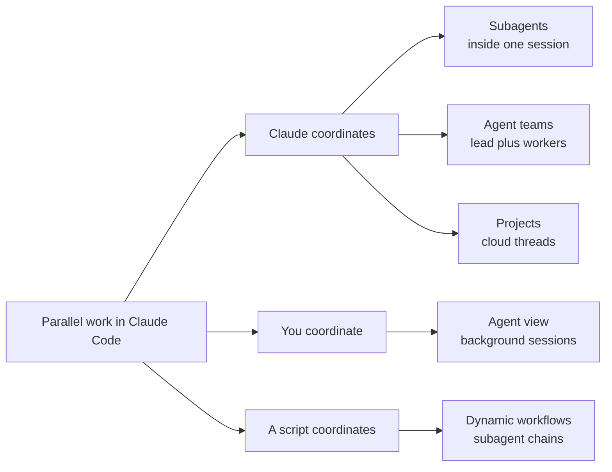

**TL;DR**

- Claude Code documents five parallel-execution approaches: subagents, agent view, [agent teams](/posts/2026-03-20-garry-tan-gstack-agent-teams-claude-code/), dynamic workflows, and Projects [1]. In our assessment, most teams need only two of them.
- Agent teams are experimental and disabled by default, and they add coordination overhead and token cost compared to a single session [2].
- Anthropic reports that Claude Tag, its Slack-native evolution of Claude Code, lands 65% of its product-engineering team's internal PRs [6].

Claude Code team workflows are the next battleground for coding agents. Individual productivity was the easy win (autocomplete, refactoring, one-shot bug fixes), and coordination is the hard part: five developers running separate sessions on one repo (a common setup) produce merge conflicts, duplicated context, and no shared record of decisions. In our assessment, Claude Code ships explicit multi-user primitives that Cursor's cited announcement does not describe. Anthropic also shares new features inside the company (and with some early customers) before wider release [6]. Our thesis: the next edge comes from orchestration (not from a bigger model). What follows maps three things: the primitives that matter, one governance setup, and the approach that fits each team.

## Why Claude Code Team Workflows Beat Solo Sessions

The individual coding-agent pitch is solved: anyone can open a terminal, describe a bug, and watch a model patch it (the demo everyone has seen). What remains unsolved is the handoff (the moment work changes hands). Picture two engineers on one feature, a reviewer catching hidden assumptions, and a lead who needs every parallel session's decisions: that is a coordination gap (not a capability gap).

Anthropic tests its own tooling internally before release: Claude Code features go to Anthropic employees and some early customers first, with internal metrics for active users and retention [6]. The team calls this "ant fooding" and works in public through shared Slack channels [6]. One recent change (reported for the most frontier model generation only) was an 80% smaller system prompt: a shift from exhaustive negative constraints toward concise instruction [6].

Cursor chases the same problem from a different angle: Projects puts a coordinator agent in the cloud that delegates to subagents [7]. Claude Code documents its own multi-user machinery (agent teams, cross-session messaging, and a local-plus-cloud execution model) [1][2]. That distinction (local sessions versus a cloud coordinator) drives everything below.

## Five Ways Claude Code Parallelizes Work

Claude Code ships five distinct ways to run work in parallel [1] (they are not interchangeable): so pick the wrong one and you trade a clean multi-session workflow for a token bill (with nothing merged). The diagram below sorts the five by coordinator (Claude, you, or a script).



| Primitive | What it does | Best for |
| --- | --- | --- |
| Subagents | Delegated workers inside one session with independent context | Splitting a single task into parallel research or edits |
| Agent view | Dispatch and monitor background sessions from one screen | Running a scan, test suite, or search while you keep working |
| Agent teams | Coordinated multi-session groups with a shared task list | Research and review that needs a lead and multiple workers |
| Dynamic workflows | Script-orchestrated chains of subagents | Work too large for turn-by-turn coordination |
| Projects | Ongoing cloud conversation where parallel threads each receive the project's instructions | Long-running work that keeps running when your machine is off |

Anthropic's original agent guidance describes an orchestrator-workers pattern: a coordinator breaks a task down and delegates the pieces to worker LLMs [10]. Claude Code's team features resemble that pattern in our assessment. Worktrees give each parallel session a separate git checkout, so parallel sessions each edit their own copy of the files, and subagents can each get their own worktree [1].

Cross-session messaging is a supporting tool for sessions you run yourself (not a sixth approach): Claude can list and message other Claude Code sessions on the same machine, on another machine, or in the cloud, which lets one session pass findings to another without manual copy-pasting [1]. For example, in our setup a review session could pass its findings back to the session that wrote the code (an illustration, not a documented workflow).

Calibrate by coordination cost: start with subagents and agent view, then climb only when the task demands it.

## Agent Teams: When More Sessions Beat More Tokens

> [!WARNING]
> Agent teams are experimental and disabled by default: enabling them adds coordination overhead and token cost compared to a single session [2]. Do not reach for them until a workload genuinely needs multiple coordinated workers.

Agent teams are the primitive built for coordinated multi-session work: a lead session coordinates multiple workers that share a task list and can message each other directly [2]. Turning them on takes one environment variable.

```bash
# Enable experimental agent teams for coordinated multi-session work
CLAUDE_CODE_EXPERIMENTAL_AGENT_TEAMS=1 claude
```

You can run the team in-process on one screen (or split it across panes with tmux or iTerm2) [2]. The lead assigns work, and teammates message each other directly (instead of routing everything through the lead). That peer-to-peer path separates a team from a simple fan-out of workers. Our rule of thumb: a research sprint often justifies the extra machinery, a routine refactor rarely does.

Each teammate is a separate Claude instance, so token cost is higher than a single session [2]. Reserve teams for research and review workflows (where parallel exploration improves the result). For a refactor, one good session is usually the cheaper path.

## Shared Context for a Claude Code Team That Persists

Parallel sessions are only as good as the context they share: Claude Code layers persistent instructions through CLAUDE.md files (loaded at the start of every session), with a .claude/rules/ directory for path-specific scoped rules [3]. [AGENTS.md](/posts/2026-05-22-agents-md-self-describing-repositories/) works as an interoperable alternative for teams that also use other coding tools [3].

Auto memory is a different layer: it lets Claude write notes from your corrections and carry them across sessions up to 200 lines or 25KB, but it is machine-local, stored under ~/.claude/projects/<project>/memory/ (not shared across machines) [3]. It is per developer (so it cannot carry a team convention). A committed CLAUDE.md is shared with the team through version control [3]. We recommend treating .claude/rules/ and skills the same way (our practice, not a documented guarantee).

Instructions are one boundary: tooling is another. The [Model Context Protocol](/posts/2026-03-04-mcp-model-context-protocol/) (MCP) is an open-source standard for connecting AI applications to external systems such as local files and databases [9]. In our view, that may reduce a team's reliance on markdown files for shared context. Code intelligence plugins pull in the same direction: they let Claude jump to definitions instead of scanning whole files (which matters most in typed languages) [5].

## Guardrails and Governance at Team Scale

More sessions mean more chances for a destructive edit to slip through, and Claude Code's answer is deterministic (never left to model judgment). Hooks enforce rules that admit no exceptions: PreToolUse hooks block actions before they run, Stop hooks prevent ending a turn until checks pass, and PostToolUse hooks run after edits [5].

A classifier in auto mode blocks high-risk actions (such as production deploys and force pushes), and new terminal sessions start in auto mode by default [5]. The model proposes: policy decides.

Here is a multi-user setup we would compose from those pieces. A PreToolUse hook can block a disallowed action before it runs (the page's own example is edits under migrations/) [5]. A Stop hook can hold a turn open until the team's checks pass [5]. A committed CLAUDE.md is shared with the team through version control, and rules in .claude/rules/ load every session or when matching files are opened [3]. In our practice, the rules then live in the repository (no teammate has to remember them).


In our view, the governance layer (not the model) is what makes multi-user Claude Code safe to scale: hooks convert an individual's judgment into a policy that every session obeys by construction.


## Slack-Native Collaboration with Claude Tag

Not every team lives in a terminal. For Slack-centric teams, Claude Tag brings Claude directly into Slack channels (with admin-governed access, on Team and Enterprise plans on Anthropic's first-party service) [4]. It supports proactive routines such as monitoring bug reports and opening PRs, and the Claude Code team describes it as the evolution of Claude Code [4][6].

In our reading, the shift moves coordination out of individual sessions (a Slack channel becomes the shared task list), and anyone in the channel can watch a fix land or a review resolve. It only pays off if the team already works in Slack: otherwise Projects and cross-session messaging stay closer to home.

## Claude Code Team Workflows vs. Cursor Projects

The two products diverge sharply once you look past autocomplete. The table below is the functional comparison: the numbers after it come from the vendors themselves (not from independent measurement).

| Tool | Team coordination approach | Deployment model | Governance layer |
| --- | --- | --- | --- |
| Claude Code | Agent teams, cross-session messaging, Claude Tag in Slack [1][4] | Local sessions plus cloud Projects [1] | Hooks and auto mode [5] |
| Cursor Projects | Coordinator agent delegating to cloud subagents [7] | Cloud-by-default [7] | Not covered in cited announcement |

Cursor reports two figures: new Projects users merge 30% more PRs, and users who primarily use Projects merge six times as many [7]. One design-system Project is on track to touch 20 to 100 PRs a day (a projection, as Cursor presents it, rather than current throughput) [7]. Cursor's Agent SDK lets teams define agents in code with built-in evals: PGA Tour uses it as their software development factory [8]. Anthropic, for its part, rewrote Bun in Rust and used it internally before a public rollout [6].

Which approach fits which team? That depends on your bottleneck: Cursor describes Projects as cloud by default [7], and in our assessment that suits a cloud-first team that wants delegation without local setup. A team that owns its own policy and works in the terminal may prefer Claude Code's hooks and committed CLAUDE.md. A Slack-centric team can start with Claude Tag. This is our assessment, not a finding of any cited page.

> [!NOTE]
> Read the benchmarks with their provenance in mind: the evidence here is vendor-originated (the 65% figure is self-reported by Anthropic's Claude Code team, and the 30% and six-times figures come from Cursor's product announcement). Each vendor is measuring its own tool.

## Practical Takeaways

1. Start with CLAUDE.md and skills before touching any experimental feature. A committed CLAUDE.md is shared through version control [3], and we suggest committing rules and skills the same way, while auto memory stays on one machine.
2. Use subagents and agent view for everyday parallel work: reserve agent teams for research and review (where their overhead is justified).
3. Enable agent teams only with CLAUDE_CODE_EXPERIMENTAL_AGENT_TEAMS=1, and measure the token cost against a single session before standardizing on them.
4. Register PreToolUse and Stop hooks before you scale past a handful of engineers (so one policy applies to every session by construction).
5. Adopt Claude Tag if your team already lives in Slack, and keep Cursor Projects in the comparison when your problem is cloud-native delegation.

## Conclusion

Shipping alone with an agent was phase one (shipping as a group is phase two). The deciding factor is not the vendor you pick: it is whether multi-session work gets its own design decisions. The sensible path is a ladder (cheapest rung first): committed instructions and hooks, subagents and agent view day to day, and multi-session teams only where the task is genuinely parallel. Before promoting any rung to a standard, run your own measurement on one real repository (not a vendor benchmark). Expect the ladder to shift as vendors ship, so revisit it each quarter (and check which rungs still earn their cost).

## Frequently Asked Questions

### Should I enable agent teams for my team?

Not by default: agent teams are experimental, off by default, and add coordination overhead and token cost over a single session [2].

### What is the difference between subagents and agent teams?

Subagents are delegated workers inside a single session with independent context, whereas agent teams are multiple coordinated sessions that share a task list and can message each other directly [2]. The practical difference is coordination topology: teams are built for peer-to-peer communication between workers, which adds token cost. If your task does not need that lateral coordination, subagents are the cheaper call. Start there, and move to a team only when workers genuinely need to challenge or build on each other's findings.

### How do I keep context consistent across a team of Claude Code users?

CLAUDE.md and .claude/rules/ load at the start of every session or when matching files are opened, while skills load only when invoked or relevant [3]. Only CLAUDE.md is documented as shared through version control, so confirm rules and skills sharing against the current docs before relying on it. Auto memory is per developer: it persists corrections up to 200 lines or 25KB, but it is machine-local and not shared across machines [3].

### What governance controls does Claude Code offer for organizations?

PreToolUse, Stop, and PostToolUse hooks enforce deterministic rules, and auto mode blocks high-risk actions such as production deploys and force pushes [5].

### Does Claude Code run only on my machine?

No. Cross-session messaging reaches sessions on the same machine, another machine, or the cloud [1].

---

## Sources

| # | Publisher | Title | URL | Date | Type |
| --- | --- | --- | --- | --- | --- |
| 1 | Anthropic | "Run agents in parallel — Claude Code Docs" | https://docs.anthropic.com/en/docs/claude-code/agents | 2026 | Documentation |
| 2 | Anthropic | "Orchestrate teams of Claude Code sessions — Claude Code Docs" | https://docs.anthropic.com/en/docs/claude-code/agent-teams | 2026 | Documentation |
| 3 | Anthropic | "How Claude remembers your project — Claude Code Docs" | https://docs.anthropic.com/en/docs/claude-code/memory | 2026 | Documentation |
| 4 | Anthropic | "Work with Claude Tag — Claude.ai Documentation" | https://docs.anthropic.com/en/docs/claude-code/claude-tag | 2026 | Documentation |
| 5 | Anthropic | "Best practices for Claude Code — Claude Code Docs" | https://docs.anthropic.com/en/docs/claude-code/best-practices | 2026 | Documentation |
| 6 | Simon Willison | "A Fireside Chat with Cat and Thariq from the Claude Code team" | https://simonwillison.net/2026/Jul/21/cat-and-thariq/ | 2026-07-21 | Blog |
| 7 | Cursor | "Introducing Projects" | https://www.cursor.com/blog/projects | 2026-09-10 | Blog |
| 8 | Cursor | "Introducing the Agent SDK" | https://www.cursor.com/blog/agent-sdk | 2026-10-20 | Blog |
| 9 | Model Context Protocol | "What is the Model Context Protocol (MCP)?" | https://modelcontextprotocol.io/introduction | 2026 | Documentation |
| 10 | Anthropic | "Building effective AI agents" | https://www.anthropic.com/engineering/building-effective-agents | 2024-12-19 | Blog |

## Image Credits

- **Cover photo**: Image generated with gemini-3-pro-image (Agents' Codex AI illustration)
