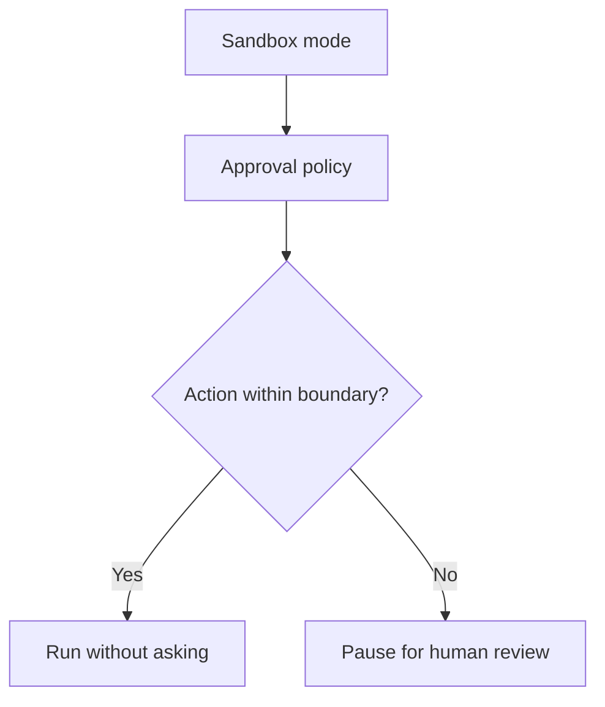
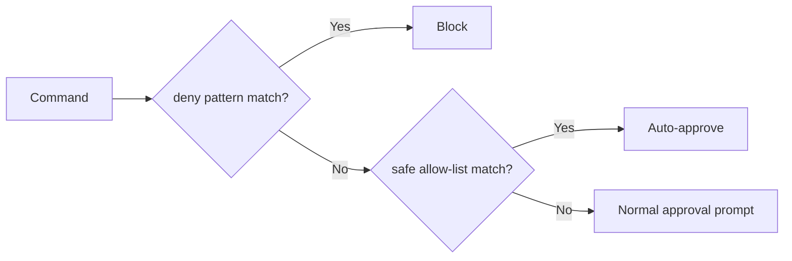

**TL;DR**

- Codex approval workflows split security into two layers: sandbox mode sets the technical boundary, and approval policy controls when the agent pauses for review [3].
- Auto-review on the Agents API uses an OpenAI-managed reviewer model that bills extra tokens on top of the agent's own model usage [1].
- The control surface is not always what it claims: user reports describe a grayed-out approval selector on macOS after a restart [7] and a missing 'Approve for me' option in the VS Code extension [8].

The moment you turn an agent loose on a repository, you are making a bet about what it should do without asking. OpenAI Codex makes that bet explicit in its codex approval workflows: a sandbox sets the technical boundary, and an approval policy decides when the agent must pause for a human [3]. Get the balance wrong and you pay: either in review fatigue or in an unbounded blast radius. The teams worth copying are not the ones that approve everything by hand, nor the ones that auto-approve everything. They are the ones that map each scenario to a specific mode, and they know the exact failure points where the on-screen control stops matching what the agent can do. That mapping is what this article builds. Most of the evidence below comes from OpenAI's own documentation and issue reports. No independent adoption study exists for these controls.

## How Codex Approval Workflows Define Your Boundaries

Three shapes exist for the approval policy: 'on-request', 'never', and a granular object whose booleans cover sandbox_approval, rules, mcp_elicitations, request_permissions, and skill_approval [5]. The granular form lets you allow low-risk classes of action while still pausing on the rest. The trade-off is direct: tighter policies cost clicks, looser ones cost risk.

Separate from the policy is the review mode on the Agents API: the session's review field accepts 'auto_review', which automatically approves or denies supported requests based on risk and user intent, or 'none', the default that applies no automatic review [1]. Omitting the field defaults to 'none'; the setting persists when a session resumes. To change it you send an explicit string value (a null is not accepted) [1].

Auto-review runs an OpenAI-managed reviewer model (whose tokens are billed on top of the agent's own model usage) [1]. It applies a permission profile with a workspace-write baseline and restricted network access; it does not override the environment's existing network restrictions or credential controls [2]. That last point matters: auto-review loosens the prompt, not the sandbox.

These settings live in different places depending on how you run Codex: the review field is an Agents API session option, and the sandbox and policy live in the configuration file [5][1]. Keeping those placement details straight is what stops a setting you changed in one surface from silently failing to apply in another. Remember one rule: a change does nothing until it lands in the surface that actually runs the agent.

```yaml
sandbox_mode = "workspace-write"
approval_policy = { sandbox_approval = true, rules = true, mcp_elicitations = true }

# Agents API session
review = "auto_review"
```

## The Two-Layer Model That Curbs Approval Fatigue

Codex's security controls come from two layers that work together: sandbox mode defines what the agent can do technically (where it can write, whether it can reach the network), while the approval policy controls when Codex must ask before executing an action [3]. The sandbox is designed in part to reduce approval fatigue [6].

The sandbox does the heavy lifting for routine work. Within the boundary you have already approved, the agent can read files, make edits, and run routine project commands without asking for confirmation on every low-risk command [6]. That throughput is the point of pairing the two layers rather than relying on prompts alone.

Three sandbox modes exist in configuration: 'read-only', 'workspace-write', and 'danger-full-access' [5]. Network access is off by default in workspace-write mode [3]. A 'danger-full-access' agent can reach the network and touch the filesystem broadly. It should always pair with an approval policy that still stops and asks on risky actions.



## When Codex Approval Workflows Should Auto-Review

Auto-review is not a costless shortcut: every request it adjudicates goes through the reviewer model, whose tokens are billed on top of the agent's model usage [1]. Enable it by scenario (trusted repo, routine maintenance, well-defined scope), not by mood. Is the trade-off ever worth it? For a locked-down CI loop, yes. The table below is a starting framework; the pattern across all four rows is the same: the narrower the scope and the more locked-down the network, the more defensible it is to let the reviewer model decide.

| Scenario | Review mode | Why |
| --- | --- | --- |
| Read-only code exploration | Manual ('none') | Nothing to break; the prompt is cheap |
| Routine dev on a trusted repo | Granular policy + 'on-request' | Low-risk actions run silently, the rest pause |
| Trusted CI-like automation, network off | 'auto_review' | Well-defined scope, reviewer model handles the volume |
| Production deploy or external network | Manual, never auto | Blast radius is too large to delegate |

> [!WARNING]
> Auto-review does not override the environment's existing network restrictions or credential controls [2]. A session running auto_review on a locked-down host is still locked down at the network and credential layers. The reviewer model only changes how requests are adjudicated, not what the sandbox permits.

## Real Bugs That Make the Control Lie to You

The four reports below are individual user filings, not official severity ratings. Each one matters: it is a case where the approval surface stopped matching what the agent could actually do. How do you tell which state you are in? You read the session logs, not the toggle.

On macOS, a reported issue shows that Statsig bootstrap timeouts after a restart can leave the approval selector grayed out and hide the user's existing dot, even when the saved preference is 'Approve for me' [7]. In the VS Code extension, a user reports the 'Approve for me' option does not appear in the approval prompt, making approval more manual than expected [8].

A user reports that Codex Desktop left them without a clear way to request review of an auto-review-denied action [9]. One open report, openai/codex #60058, says the Full access control disappears after chat creation while the context reports workspace-write with restricted network [10].

> [!IMPORTANT]
> None of these four issues describes a resolution or workaround in the report itself. Treat the visible toggle as a hint, not a guarantee, and verify the effective permissions in the logs rather than trusting the UI.

## The Security Risks That Over-Automation Invites

An independent analysis of autonomous agents identifies four critical vulnerabilities: destructive actions on downstream services, sensitive data exfiltration, credential exfiltration, and credential misuse [11]. In our reading, sandboxes and approval prompts exist to close those four paths, not to decorate the product.

The same analysis names a 'lethal trifecta': private data access, external communication, and exposure to untrusted content: the combination that makes an agent prone to [prompt injection](/posts/2026-04-03-owasp-top-10-agentic-apps-security-guardrails/) [11]. Notice how it maps onto Codex's own knobs: private data access and external communication are precisely what 'danger-full-access' and network access control govern.

Even OpenAI's own safety monitoring is a backstop, not a primary control. GPT-6 Astra (OpenAI's own safety monitor) can pause a task after detecting potentially unsafe model behavior, but the pause can arrive after the triggering activity; monitoring does not replace sandboxing or permissions [3]. Does a backstop like that make manual review optional? No, because the pause can arrive too late [3]. OpenAI's guardrails guide describes human review as pausing a run so a person or policy can approve or reject a sensitive action [4].

## Community Guardrails Fill the Gaps Codex Leaves Open

Teams are not waiting for vendor fixes. A cluster of open-source tools has grown around one idea: approval should be finer-grained than a single mode switch.

mmi (short for 'Mother May I?') sits between Claude Code and Bash with a three-layer model: deny patterns are checked first, safe commands are explicitly allow-listed and auto-approved, and everything else falls through to the normal approval prompt [12]. The ordering matters: deny patterns are checked first and are always rejected [12].



AgentPort is an open-source gateway that connects agents to third-party services. Administrators set per-action permissions: a team can auto-approve 'list_customers' on Stripe while still requiring approval for 'create_refund' [13]. Trollbridge targets the network side with a smart HTTP/S proxy that applies sticky allow/deny policies to agent outbound traffic [14].

## Approval Settings by Scenario

The recommendations below combine the configuration options documented across the sandbox, approval policy, and review mode references [5][1][2] into one decision table. Use the row that matches what the agent is about to do.

| Goal | sandbox_mode | approval_policy / review |
| --- | --- | --- |
| Read-only exploration | read-only | on-request |
| Routine development | workspace-write | on-request with granular rules |
| Trusted CI-like automation | workspace-write, network disabled | review = auto_review |
| Multi-repo / enterprise | managed requirements.toml | allowed_approval_policies + network_proxy |


Pick the sandbox boundary first, then decide how often a human must be in the loop. Reversing that order is how teams end up auto-approving things they never meant to allow.


## Practical Takeaways

1. Codex has two layers, sandbox mode and approval policy [3]; we recommend deciding the sandbox boundary first, then how often a human must be in the loop.
2. Enable auto_review only on scoped repos with network disabled (our recommendation), and expect the extra reviewer tokens on the bill [1].
3. Because one user reports the approval selector grayed out after an app restart [7], confirm it is active after restarting rather than assuming it still works.
4. For shell-heavy agents, add a deny-first allow-list like mmi's (deny first, allow-list second) so dangerous patterns are blocked before the allow-list is even consulted [12].

## Conclusion

The on-screen mode is not the permission the agent actually holds: the Windows discrepancy is one reported example of that gap [10]. Set the sandbox boundary first, turn up review automation only where scope is narrow and the network is off, and audit session logs rather than trusting the UI. The question worth tracking is whether these mismatch reports mark a fix in progress or a deeper split between the desktop app and the API. Until that is resolved, verify effective permissions in the logs before you hand an agent anything you could not afford to lose.

## Frequently Asked Questions

### Does auto-review cost extra to run?

Yes. Auto-review uses an OpenAI-managed reviewer model whose tokens bill on top of the agent's own usage [1]. Budget for it like any other model call.

### Can I override an auto-review denial?

Not cleanly. A user reports Codex Desktop offers no clear review path after an auto-review denial [9].

### When should I ever use 'danger-full-access'?

Almost never. It lets the agent reach the network and touch the filesystem broadly, so pair it only with an approval policy that still pauses on risky actions. See the scenario table for what to use instead.

### Why is 'Approve for me' missing in my editor?

A user reports the 'Approve for me' option does not appear in the VS Code extension's approval prompt, making approval more manual than expected [8]. The report names no workaround.

### Do open-source tools like mmi or AgentPort replace Codex's controls?

No. mmi adds a deny-first command allow-list between an agent and Bash, checking dangerous patterns before anything else and auto-approving only explicitly safe commands [12]. AgentPort adds per-action permissions for third-party services, so you can approve a read while still gating a refund [13]. Trollbridge sits on the network side with sticky allow/deny policies for outbound traffic [14]. None of these replace the sandbox, which still defines the filesystem and network boundary, or the approval policy, which still governs when a human is asked. They fill the gaps in Codex's native approval workflows rather than substituting for them.

---

## Sources

| # | Publisher | Title | URL | Date | Type |
| --- | --- | --- | --- | --- | --- |
| 1 | OpenAI | "Automatic review" | https://developers.openai.com/api/docs/guides/agents-api/sessions/approvals | 2026-11-13 | Documentation |
| 2 | OpenAI | "Sandbox security" | https://developers.openai.com/api/docs/guides/agents-api/environments/security | 2026-11-13 | Documentation |
| 3 | OpenAI | "Agent approvals & security" | https://learn.chatgpt.com/docs/agent-approvals-security | undated | Documentation |
| 4 | OpenAI | "Guardrails and human review" | https://developers.openai.com/api/docs/guides/agents/guardrails-approvals | 2026-11-13 | Documentation |
| 5 | OpenAI | "Configuration Reference" | https://learn.chatgpt.com/docs/config-file/config-reference | undated | Documentation |
| 6 | OpenAI | "Sandbox" | https://learn.chatgpt.com/docs/sandboxing | undated | Documentation |
| 7 | GitHub (openai/codex community) | "[macOS] Approval selector disabled and existing dot disappears after restart; Statsig bootstrap timeouts" | https://github.com/openai/codex/issues/55142 | 2026-10-18 | Technical |
| 8 | GitHub (openai/codex community) | "[VS Code / WSL] 'Approve for me' option is missing from approval UI" | https://github.com/openai/codex/issues/51278 | 2026-10-06 | Technical |
| 9 | GitHub (openai/codex community) | "Codex Desktop: no clear review path after an Auto-review denial" | https://github.com/openai/codex/issues/59940 | 2026-11-06 | Technical |
| 10 | GitHub (openai/codex community) | "[Windows / ChatGPT Work] Full access control disappears; command runner retains restricted network" | https://github.com/openai/codex/issues/60058 | 2026-11-07 | Technical |
| 11 | yakko.dev | "On agents dropping production databases" | https://yakko.dev/blog/on-agents-dropping-production-dbs | 2026-04-27 | Blog |
| 12 | dangerlanc.com | "mmi: A Permission Layer for Claude Code" | https://dangerlanc.com/writing/mmi/ | 2026-01-20 | Blog |
| 13 | Hacker News (yakkomajuri / AgentPort) | "Show HN: AgentPort – Open-source Security Gateway For Agents" | https://news.ycombinator.com/item?id=47950752 | 2026-04-29 | News |
| 14 | Hacker News (dandriscoll / Trollbridge) | "Show HN: Trollbridge – let your agent run YOLO but without the whole internet" | https://news.ycombinator.com/item?id=48850008 | 2026-07-09 | News |

## Image Credits

- **Cover photo**: Image generated with gemini-3-pro-image (Agents' Codex AI illustration)
