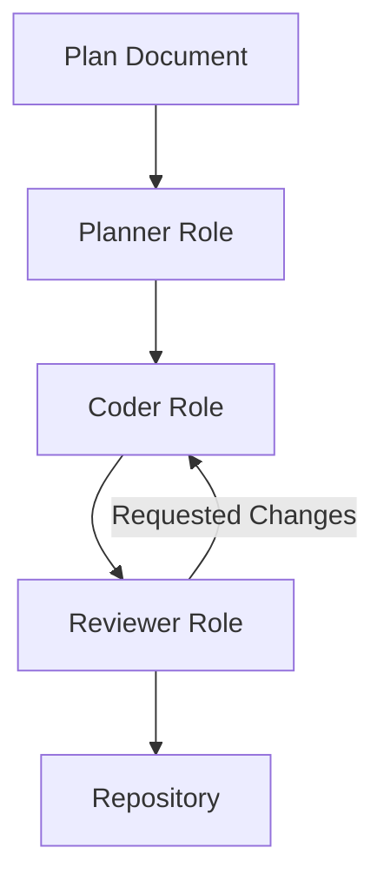

**TL;DR**

- `codex exec` runs Codex headlessly and pipes JSON Lines or schema-validated output to downstream tools, which is what makes repository-wide automation scriptable [3].
- Sandbox modes (`read-only`, `workspace-write`, `danger-full-access`) bound what a CLI run can touch, while the official Action adds permission profiles (`:read-only`, `:workspace`) and a `drop-sudo` safety-strategy on top [4] [5].
- OpenAI's harness-engineering team reports 3.5 PRs per engineer per day on a greenfield product of roughly one million agent-generated lines, and the neal orchestrator landed a 3,000-file Ember migration with 549 commits [1] [7].

Running Codex agents over codebases is where a demo becomes infrastructure. Interactive use feels like magic until the work outgrows a single file — a single-session edit does not scale, and you cannot hand an autonomous agent your repo without a safety model. The threshold is not the model — it is the harness layered around it (the sandbox, the GitHub Action, the plan). Codex crosses that line with a non-interactive exec mode, OS-backed sandbox modes, an official GitHub Action, and plan-driven orchestration wrappers. OpenAI's own harness-engineering team already runs this pattern at scale, as a greenfield product built from an empty repository with roughly a million lines of entirely agent-generated code [1]. The Codex CLI repository shows about 136k stars as of November 2026 [2]. This article maps the patterns that keep those runs safe. Most of the evidence below is OpenAI's own documentation: treat its numbers as vendor-reported.

## Run Codex Agents Over Codebases With the codex exec Mode

For unattended batch work, Codex ships a non-interactive mode: `codex exec <prompt>`. It streams progress to stderr and prints only the final agent message to stdout, so its output is pipe-friendly [3]. That one design choice is what separates a one-off demo from a scriptable step in a pipeline.

```bash
codex exec "Audit src/ for deprecated API calls" --json --output-schema audit-schema.json
```

The `--json` flag emits a JSON Lines stream with events such as `thread.started`, `turn.started`, `turn.completed`, `turn.failed`, `item.*`, and `error` — a downstream step can parse that stream without scraping human-readable text [3]. The `--output-schema` flag accepts a JSON Schema file: structured results such as project metadata or risk reports come back machine-readable [3].

Sandbox behavior is controllable non-interactively with `--sandbox workspace-write` or `--sandbox danger-full-access`, and `--approve-for-me` routes approval requests through automatic review under the workspace-write sandbox [3]. The older `--full-auto` flag is no longer supported — scripts should use `--sandbox workspace-write` or `--approve-for-me` instead [3].

How do you reopen a run you paused? `codex exec resume --last` continues the previous non-interactive session [3]. Multi-stage pipelines get two more primitives: `--ephemeral` discards session rollouts for stateless runs, and piped stdin becomes additional context when a prompt argument is also provided [3]. By default `codex exec` requires a Git repository, and `--skip-git-repo-check` overrides that for controlled environments (such as a CI container) [3].

## Separate Sandbox Modes From Action Permission Profiles

Two different controls share similar names, and conflating them breaks setups. The Codex CLI has three sandbox modes: `read-only`, `workspace-write`, and `danger-full-access`, set via `--sandbox` or the `sandbox_mode` key in `config.toml` [4]. The `openai/codex-action@v1` GitHub Action, by contrast, takes a `permission-profile` input with built-in values `:read-only` and `:workspace` [5].

These do not compose. The Action's legacy `sandbox` input defaults to `workspace-write` for backward compatibility, but supplying both a `permission-profile` and a `sandbox` causes the Action to fail before Codex starts [5] [6]. Copying `permission-profile: workspace-write` from a CLI reference into the Action is the exact failure mode to avoid: the Action expects the colon-prefixed `:workspace`, not the CLI's bare `workspace-write` [5] [6].

Which one do you set? It depends on the surface you are automating: the CLI's `--sandbox` for local runs, the Action's `permission-profile` for CI [4] [5].

| Sandbox mode | What it allows | When to use it |
| --- | --- | --- |
| read-only | Inspect code but make no edits | First-pass audits and analysis |
| workspace-write | Read and edit the workspace, run routine local commands | Most scoped automation jobs |
| danger-full-access | No sandbox restrictions | Only when you fully trust the inputs |

On Linux these modes are backed by a real sandbox that requires `bubblewrap` (`bwrap`) installed, and Ubuntu 24.04 may need an extra AppArmor profile, `bwrap-userns-restrict`, loaded first [4]. The mode is the line between bounded and unbounded automation: an agent that can write anywhere and reach the network can do anything a shell script with your credentials could do, and no one sees it until it is done.

> [!WARNING]
> Start every automated job at the most restrictive mode that can do the work, and widen only when the job fails for lack of permission. Widening first turns an unattended run into an unplanned one.

## Integrate Codex Into CI Without Handing It the Keys

The official `openai/codex-action@v1` turns a GitHub Actions job into a controlled Codex run. It installs the CLI and starts a secure Responses API proxy (a local shim that forwards prompts to OpenAI) (accepting `prompt`, `permission-profile`, `output-schema`, `model`, `effort`, and `safety-strategy` inputs [5]). The default `safety-strategy` is `drop-sudo` (revoking sudo, dropping supplementary groups, and emptying capability sets); `unprivileged-user` and `read-only` are the alternatives [5]. Access control is explicit too: by default the Action runs only for users with write access, and you allowlist more with `allow-users`, or trusted bots with `allow-bots` or `allow-bot-users` [5].

The documented pattern separates Codex execution from patching. The official README example runs Codex in a job with `contents: read` and a separate `post_feedback` job with `issues/pull-requests: write`, so the run that edits and the step that opens a change do not share one permission budget [5].

Three risks from the Action's own security guide deserve attention before you schedule unattended runs [6]. First, prompt injection: pull-request bodies through HTML comments, commit messages, repository instruction files, and screenshots can all carry instructions an unsandboxed agent will follow [6]. Second, key exposure: combining read-only filesystem access with passwordless `sudo` (the default on GitHub-hosted runners) can leak the `OPENAI_API_KEY` through Linux procfs [6]. Third, quota abuse: configuring `allow-users: "*"` lets outsiders use the repository's API quota to get Codex to do work on their behalf [6].

> [!CAUTION]
> Treat every repository input a run touches, whether PR bodies, commit messages, or instruction files, as untrusted, and pair `drop-sudo` with the narrowest permission profile that can do the work.

OpenAI also recommends running the Action as the last step in a job [6]. Keeping Codex last means the only thing downstream is the step that opens the pull request; that is exactly where surprise writes are least welcome.

## Coordinate Codex Agents Over Codebases With Orchestration Tools

Single-session runs fall apart on large migrations for one reason Lee Nave named: context rot (when early decisions fade as the session grows). Over a long session, old instructions and decisions lose influence as the context grows or is compacted [7]. Community tools fight this by splitting work into roles and scopes around a plan document. Why does a plan document matter more than a bigger context? Because the plan survives compaction — the conversation does not.

neal, a local CLI by Lee Nave [7] [8], coordinates a planner, a coder, and a reviewer around a plan document. The coder starts each scope with a fresh context — the read-only reviewer keeps its context across scopes and checks each commit against that scope [7]. Its `neal compat` command checks 90 OpenRouter models and found 44 capable of speaking neal's protocol across all three roles [7]. The plan document, not the conversation, is the durable memory.



Two lighter-weight tools take the same shape. Codex Symphony is a portable bootstrap that installs a local Symphony plus Linear setup into any repository, then lets Codex pick up Todo issues and work them in isolated workspaces [9]. ExecPlan templates from `openai-codex-exec-plan` are structured markdown plans that Codex copies per task into `.agents/<feature>/PLAN.md`; one ExecPlan maps to one task, a feature, refactor, or bug fix, so it is a scoped planning template rather than a multi-task orchestrator [10].

## What Scale Actually Looks Like in Production

The strongest repository-wide evidence is a first-party greenfield experiment, not a benchmark. OpenAI's harness-engineering team started from an empty git repository and built a product with roughly one million lines of entirely agent-generated code over five months, averaging 3.5 PRs per engineer per day (about 1,500 PRs in total) across a team that grew from three to seven engineers [1]. The first commit landed in an empty repository with no pre-existing human-written code to anchor the system, so this is a from-scratch build rather than a migration of an existing codebase [1]. It is also OpenAI describing its own result, not an independent study.

A community case study shows the same principle at a reachable scale. Lee Nave used neal to coordinate models around a plan for an Ember.js upgrade (a framework-wide migration), landing over 3,000 files across 549 commits and adding roughly 13,000 lines of test code, with a fresh context per scope for the coder [7].

The harness-engineering team kept its `AGENTS.md` around 100 lines, using it as a table of contents that points into a structured docs directory rather than a monolithic file, to avoid stale rules [1]. A short instruction file plus a docs directory gives the agent a single, current source of truth, and fresh contexts per scope stop old reasoning from leaking into new work. Neither trick depends on a particular model.


The plan and the scoped context, not the model, are what let an agent touch thousands of files without drifting. Keep instructions short and structured, and reset the coder's context per scope.


## Know What the Batch API Does, and Does Not, Apply To

The OpenAI Batch API processes bulk requests submitted as `.jsonl` files against standard endpoints: responses, chat completions, embeddings, images, and moderations, with a 50% cost discount compared to synchronous APIs and a 24-hour turnaround guarantee [11]. It is a general OpenAI Platform feature for batching API request files, not a Codex CLI integration.

Does that 50% discount apply to a Codex agent run? No cited source says it does [11]. The discount applies to your own API request files, not to a Codex agent's repository run, and batching bulk requests is a cost lever for the surrounding pipeline (such as a nightly evaluation sweep) rather than a change to the sandbox discipline a Codex run still needs.

## Practical Takeaways

1. Reach for `codex exec` for headless runs, and emit `--json` plus `--output-schema` so a downstream step validates structured output instead of auditing free-form edits [3].
2. Pick the most restrictive sandbox mode that can do the job, verify `bubblewrap` and the AppArmor profile on Ubuntu 24.04 are present, and offset Action runs with `drop-sudo` plus a narrow `permission-profile` [4] [5] [6].
3. Split the CI work the way the README shows: a codex job with `contents: read` and a separate `post_feedback` job with `issues/pull-requests: write`, and run Codex last [5] [6].
4. For migrations larger than a single session, use a plan-driven tool: with neal, reset the coder's context per scope [7], while ExecPlan gives each task a scoped plan template [10].
5. Reserve the Batch API's 50% discount for bulk `.jsonl` request files against standard endpoints, not for Codex agent runs, which no cited source connects to it [11].

## Conclusion

The hard part of Codex at scale was never the model; it was the harness. What the successful setups share is a willingness to give the agent less, not more: a narrow scope, a short structured plan, and a reset context at the right boundary (per scope, not per session). Watch for the next shift to be in defaults rather than configuration. The moment the safest sandbox becomes the out-of-the-box choice, a team's first unattended run stops being an accident waiting to happen and becomes a routine audit. Start now by running that audit yourself: `codex exec --json` on a read-only basis over a real repository, bubblewrap confirmed, and nothing the run touches treated as safe input.

## Frequently Asked Questions

### Which should I use, a sandbox mode or a permission profile?

They are two different controls for two different surfaces. The Codex CLI uses sandbox modes such as `read-only`, `workspace-write`, and `danger-full-access`, set via `--sandbox` or `sandbox_mode` [4]. The `openai/codex-action` GitHub Action uses a `permission-profile` with built-in values `:read-only` and `:workspace`, and mixing the legacy `sandbox` input with a permission profile makes the Action fail before Codex starts [5] [6]. Start at the most restrictive option on whichever surface you are using. The three CLI modes are compared in the table in the sandbox section above.

### Does the Codex sandbox work the same on every OS?

The modes are enforced differently per platform. On Linux the sandbox requires `bubblewrap` (`bwrap`) installed, and Ubuntu 24.04 may need an extra AppArmor profile, `bwrap-userns-restrict`, loaded first [4].

### How does the GitHub Action keep an automated run safe?

It defaults to a `drop-sudo` safety-strategy that revokes sudo, drops supplementary groups, and empties capability sets, and it only runs for users with write access unless you allowlist more [5]. OpenAI recommends running it as the last step in a job [6]. The security guide also flags three risks to design around: prompt injection through pull-request bodies and commit messages, `OPENAI_API_KEY` exposure when read-only access pairs with passwordless `sudo`, and quota abuse when `allow-users: "*"` is set [6].

### How do community tools handle long migrations?

They split work into roles and scopes so a single run never carries too much context. neal coordinates a planner, a coder, and a reviewer around a plan document; the coder starts each scope fresh while the read-only reviewer keeps its context across scopes [7]. ExecPlan templates go the other direction from a monolithic prompt, giving each feature its own scoped markdown plan copied into a `.agents/` folder [10]. The shared idea is that the plan, not the conversation, carries memory across a long migration. These descriptions come from each project's own documentation, and we have not found an independent comparison of the tools.

### When should I use the Batch API instead of synchronous calls?

Use it for batching your own API requests as `.jsonl` files against standard endpoints, where the 50% cost discount and 24-hour turnaround are acceptable [11]. It is not a route for Codex agent runs: no cited source shows `codex exec` or a Codex agent submitting to the Batch API [11].

---

## Sources

| # | Publisher | Title | URL | Date | Type |
| --- | --- | --- | --- | --- | --- |
| 1 | OpenAI | "Harness engineering: leveraging Codex in an agent-first world" | https://openai.com/index/harness-engineering/ | 2026-02-11 | Blog |
| 2 | GitHub | "OpenAI Codex CLI Repository" | https://github.com/openai/codex | undated | Documentation |
| 3 | OpenAI | "Non-interactive mode" | https://learn.chatgpt.com/docs/non-interactive-mode.md | undated | Documentation |
| 4 | OpenAI | "Sandbox" | https://learn.chatgpt.com/docs/sandboxing.md | undated | Documentation |
| 5 | OpenAI | "Codex GitHub Action README" | https://raw.githubusercontent.com/openai/codex-action/main/README.md | undated | Documentation |
| 6 | OpenAI | "Codex GitHub Action Security Guide" | https://raw.githubusercontent.com/openai/codex-action/main/docs/security.md | undated | Documentation |
| 7 | Lee Nave (navels.dev) | "neal: coordinating different models on complex coding projects" | https://navels.dev/blog/neal/ | 2026-08-04 | Blog |
| 8 | Lee Nave | "neal GitHub Repository" | https://github.com/navels/neal | undated | Documentation |
| 9 | Citedy | "Codex Symphony GitHub Repository" | https://github.com/Citedy/codex-symphony | undated | Documentation |
| 10 | Aditya Advani | "OpenAI Codex Exec Plan Templates" | https://github.com/ninjaa/openai-codex-exec-plan | undated | Documentation |
| 11 | OpenAI | "Batch API" | https://developers.openai.com/api/docs/guides/batch.md | undated | Documentation |

## Image Credits

- **Cover photo**: Image generated with gpt-5.4-image-2 (Agents' Codex AI illustration)
