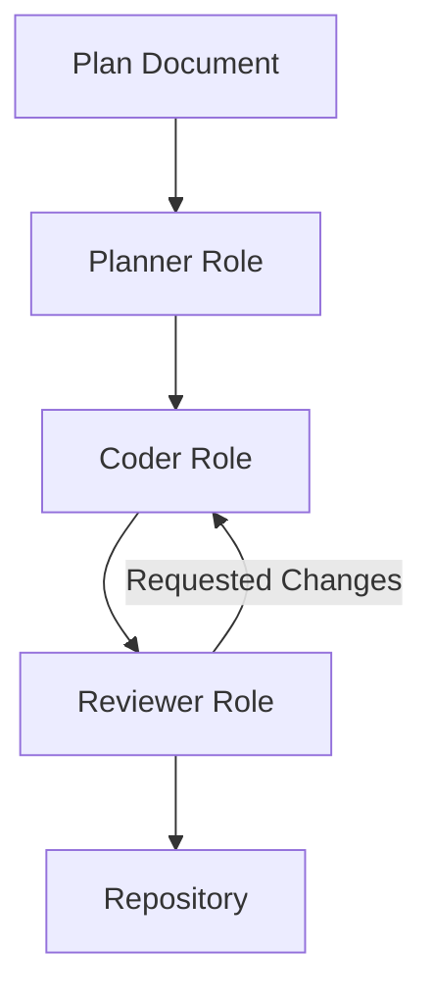

**TL;DR**

- Built-in permission profiles (`read-only`, `workspace-write`, `danger-full-access`) plus OS-level sandboxing are the controls that bound unattended batch runs [1] [2].
- The official openai/codex-action defaults to `drop-sudo` and only runs for users with write access [4]. In our assessment, those defaults describe a least-privilege posture for CI automation.
- OpenAI's harness-engineering team reports 3.5 PRs per engineer per day across a team that grew from three to seven engineers on roughly one million lines of agent-generated code, while the neal orchestrator landed a 3,000-file migration [6] [7].

OpenAI Codex batch operations are where the tool stops being a demo and starts being infrastructure. Running Codex interactively feels like magic until you need it to touch a whole repository overnight. A single-file session does not scale: you cannot sit through hundreds of files, and you cannot hand an autonomous agent your repo without a safety model. The real threshold is not the model; it is the harness around it. Codex crosses that line with sandbox profiles, an official GitHub Action, and orchestration wrappers, and OpenAI's own harness-engineering team already runs it over roughly a million lines of agent-generated code [6]; the Codex CLI repository shows 136.2k stars as of November 2026, [10]. This article maps the patterns that keep it safe. Most of the evidence below is OpenAI's own documentation, so treat its numbers as vendor-reported.

## Why OpenAI Codex Batch Needs a Sandbox, Not Just a Prompt

A non-interactive run has no human watching the first edit: the permission model has to do the watching. Codex ships three built-in permission profiles: `read-only`, which can inspect but not edit; `workspace-write`, which allows reads, edits within the workspace, and routine local commands; and `danger-full-access`, which applies no sandbox restrictions [1]. Picking the right profile is the single most important decision in a setup: it bounds what a confused agent can do before a human notices.

Those profiles are enforced by a real operating system sandbox, not just a policy flag; the Codex sandbox uses macOS Seatbelt, Linux bubblewrap plus seccomp-bpf, and the Windows native sandbox, keeping the agent inside the filesystem and network boundaries its profile allows [2]. On Linux, `bubblewrap` (`bwrap`) should be installed first as a recommended prerequisite: Codex falls back to a bundled helper if it is absent [1]. Ubuntu 24.04 may also need an extra AppArmor profile named `bwrap-userns-restrict` loaded [1]. The safety model is concrete and inspectable: exactly what an unattended batch job requires.

Why does least privilege matter more here than in an interactive session? There is no human to veto a bad step; an agent that can write anywhere and reach the network can do anything a shell script with your credentials could do, and no one sees it until it is done. The profile is the line between two states: bounded automation and unbounded automation.

| Profile | What it allows | When to use it |
| --- | --- | --- |
| :read-only | Inspect code but make no edits | First-pass analysis and audits |
| workspace-write | Read and edit the workspace, run routine local commands | Most scoped automation jobs |
| :danger-full-access | No sandbox restrictions | Only when you fully trust the inputs |

> [!WARNING]
> Start every automated job at the most restrictive profile that can do the work, and widen only when the job fails for lack of permission. Widening first is how an unattended run becomes an unplanned one!

## Run Codex in CI Without Handing It the Keys

The official `openai/codex-action@v1` turns a GitHub Actions job into a controlled Codex run. It installs the CLI, starts a secure proxy for the Responses API, and accepts inputs that shape the run: `prompt`, `permission-profile`, `output-schema`, `model`, `effort`, and `safety-strategy` [4]. The default `safety-strategy` is `drop-sudo`, which revokes sudo, drops supplementary groups, and empties capability sets on Linux and macOS — with `unprivileged-user` and `read-only` as alternatives [4]. Why does that default matter? A CI runner already has credentials and network access a local prototype lacks.

Access control is equally explicit. By default the action runs only for users with write access: you allowlist more with `allow-users`, and trusted bots with `allow-bots` or `allow-bot-users` [4]. OpenAI also recommends running `openai/codex-action` as the last step in a job, because Codex may spawn persistent processes or overwrite the action's own source after it exits [5]. In our assessment, that recommendation matters because anything after the Codex step can be racing an agent that is still finishing.

The practical shape is a two-phase job. A read-only setup step prepares the environment — then the Codex step runs against a narrow profile and emits a structured artifact that a final step turns into a pull request. Keeping Codex last means the pull-request step is the only thing downstream: that is exactly where surprise writes are least welcome.

> [!TIP]
> Pair a narrow profile with a verified output schema: the downstream step then validates structured output instead of auditing free-form edits!

## Coordinating OpenAI Codex Batch Runs Across a Repository

Single-session runs break down on real migrations for one reason: context rots as the work grows. Community tools solve this by splitting the job into scoped roles and plans. neal, a local CLI by Lee Nave, coordinates a planner, a coder, and a reviewer around a plan document, and starts every scope with a fresh Codex context to prevent context rot [7] [8]. Its `neal compat` command checks 90 OpenRouter models and found 44 capable of speaking neal's protocol across all three roles [7]. Starting fresh per scope is the core idea: the plan document is the durable memory, while each execution context stays small enough to stay coherent.

A second approach is an issue-to-pull-request pipeline. Codex Symphony is a portable bootstrap that installs a local Symphony plus Linear setup into any repository: Codex then picks up Todo issues and works them in isolated workspaces [9]. ExecPlan templates from `openai-codex-exec-plan` take another route: structured markdown plans that Codex copies per task into `.agents/<feature>/PLAN.md` as task-scoped plans [11]. Across neal, Symphony, and ExecPlan you see one pattern: narrow the scope first, then let the agent act, because the plan is what keeps a long run from wandering.

## What Scale Actually Looks Like in Production

The strongest evidence for repository-wide Codex automation is a first-party experiment, not a benchmark: OpenAI's harness-engineering team built a product with roughly one million lines of entirely agent-generated code over five months, averaging 3.5 PRs per engineer per day across a team that grew from three to seven engineers [6]. Note the framing: this is OpenAI describing its own result, not an independent study, and it reflects an unusually favorable setup of tooling and supervision.

A community case study shows the same principle at a more reachable scale. Lee Nave used neal to coordinate models around a plan for an Ember.js upgrade: landing over 3,000 files across 549 commits and adding roughly 13,000 lines of test code, with fresh-agent contexts per scope [7]. A short instruction system shows up in the harness-engineering team's setup: that team kept its `AGENTS.md` around 100 lines, using it as a table of contents that points into a structured docs directory rather than a monolithic file, to avoid context rot and stale rules [6].

One detail separates these examples from an ordinary codegen demo: supervision structure. A short instructions file plus a docs directory gives the agent a single, current source of truth; fresh contexts per scope stop old reasoning from leaking into new work. Neither trick depends on a particular model — both are habits any team can adopt on Monday.


The plan and the scoped context, not the model, are what let an agent touch thousands of files without drifting. Keep instructions short and structured, and reset context per scope!


## Cutting OpenAI Codex Batch Costs With the Batch API

Repository-wide automation is also a cost problem: a bulk path changes the economics. The OpenAI Batch API gives a 50% cost discount compared to synchronous APIs for processing requests in bulk, with a 24-hour turnaround guarantee [3]. Does that discount matter? It is the difference between a nightly sweep you run and one you skip because the synchronous bill was too high.

The Batch API is asynchronous, so it fits jobs that need no real-time answer: dependency sweeps, style checks, and bulk code reviews queued overnight. [Cost optimization](/posts/2026-05-01-visual-gui-agents-production-computer-vision/) is one more reason the harness matters: a batch submission needs the same permission discipline as an interactive run, applied to thousands of requests at once. Batching is not a substitute for least privilege — it is the pricing layer that makes least-privilege automation affordable enough to run.

## Practical Takeaways

1. Pick the most restrictive permission profile that can do the job, and verify the OS sandbox (bubblewrap on Linux, including the AppArmor profile on Ubuntu 24.04) is present before scheduling unattended runs [1].
2. Adopt the official openai/codex-action with its default drop-sudo safety-strategy, restrict triggering to write-access users, and make the Codex step the last in the job [4] [5].
3. For any migration larger than a single session, use a plan-driven orchestrator like neal or ExecPlan [7] [11], and add the per-scope context reset that neal provides [7] so the plan, not the context, is the durable memory.
4. Route overnight and bulk work through the Batch API's 50% discount and 24-hour turnaround instead of synchronous calls [3].
5. Keep your instructions file short and structured, pointing into a docs directory, rather than growing one monolithic prompt [6].

## Conclusion

The demo-to-production gap is rarely about model quality — it is about the harness that bounds what a running agent can touch, and the plan that keeps a long run pointed the same way. Both teams here converged on the same recipe: narrow scope, short structured instructions, and fresh context per unit of work. Start there rather than chasing the widest access you can get away from; the next milestone is not a bigger model, but sandbox defaults that make the safest profile the path of least resistance, so a team's first unattended run is a read-only audit by default. Your first step is concrete: run that audit on a real repo with bubblewrap confirmed and the sandbox locked down.

## Frequently Asked Questions

### Which permission profile should I start with for automation?

Start with `:read-only` for audits, then move to `workspace-write` for scoped edits. The profile table in the sandbox section above shows what each one allows. We reserve `:danger-full-access` only for inputs we fully trust.

### Does the Codex sandbox work the same on every OS?

No. It uses macOS Seatbelt, Linux bubblewrap plus seccomp-bpf, and the Windows native sandbox [2]. On Linux, `bubblewrap` should be installed first, and Ubuntu 24.04 may need an extra AppArmor profile loaded [1].

### How does the GitHub Action keep an automated run safe?

It defaults to a drop-sudo safety-strategy that does three things: revokes sudo, drops supplementary groups, and empties capability sets, and it only runs for users with write access unless you allowlist more [4]. OpenAI recommends running it as the last step in a job [5].

### How do community tools handle long migrations?

They split work into roles and scopes so a single run never carries too much context. neal coordinates a planner, a coder, and a reviewer around a plan document, and it starts every scope with a fresh Codex context to prevent context rot [7]. ExecPlan templates go the opposite direction from a monolithic prompt: each feature gets its own scoped markdown plan copied into a .agents/ folder, so the agent works against a bounded plan rather than an open-ended instruction set [11]. The shared idea is that the plan, not the conversation, carries the memory across a long migration. Note that these descriptions come from each project's own documentation. We have not found an independent comparison of these tools.

### When should I use the Batch API instead of synchronous calls?

Use it for asynchronous bulk work like overnight sweeps and bulk reviews, where the 50% cost discount and 24-hour turnaround are acceptable [3].

---

## Sources

| # | Publisher | Title | URL | Date | Type |
| --- | --- | --- | --- | --- | --- |
| 1 | OpenAI | "Sandbox | ChatGPT Learn" | https://learn.chatgpt.com/docs/sandboxing.md | undated | Documentation |
| 2 | OpenAI | "Inside the Codex sandbox" | https://openai.com/index/inside-the-codex-sandbox/ | 2026-11-18 | Blog |
| 3 | OpenAI | "Batch API | OpenAI API" | https://developers.openai.com/api/docs/guides/batch | undated | Documentation |
| 4 | OpenAI | "Codex GitHub Action README" | https://github.com/openai/codex-action/blob/main/README.md | undated | Documentation |
| 5 | OpenAI | "Codex GitHub Action Security Guide" | https://raw.githubusercontent.com/openai/codex-action/main/docs/security.md | undated | Documentation |
| 6 | OpenAI | "Harness engineering: leveraging Codex in an agent-first world" | https://openai.com/index/harness-engineering/ | 2026-02-11 | Blog |
| 7 | Lee Nave (navels.dev) | "neal: coordinating different models on complex coding projects" | https://navels.dev/blog/neal/ | 2026-08-04 | Blog |
| 8 | Lee Nave | "neal GitHub Repository" | https://github.com/navels/neal | undated | Documentation |
| 9 | Citedy | "Codex Symphony GitHub Repository" | https://github.com/Citedy/codex-symphony | undated | Documentation |
| 10 | GitHub | "OpenAI Codex CLI Repository" | https://github.com/openai/codex | undated | Documentation |
| 11 | Aditya Advani | "OpenAI Codex Exec Plan Templates" | https://github.com/ninjaa/openai-codex-exec-plan | undated | Documentation |

## Image Credits

- **Cover photo**: Image generated with gpt-5.4-image-2 (Agents' Codex AI illustration)
