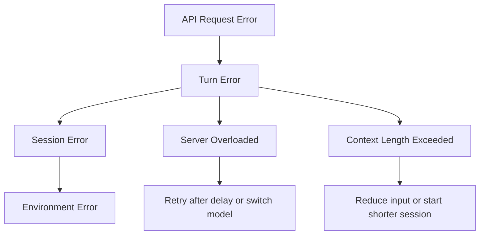

**TL;DR**

- Three failure classes recur in open GitHub issues in openai/codex as of November 2026: token_budget context loss, connector PR review hallucinations, and WSL migration chat loss [1][2][8].
- OpenAI's Agents API sorts errors into four buckets and ties each to a recovery path [4].
- Rate limits recover via a Retry-After header or exponential backoff with jitter when that header is absent [5]. Braintrust names four span types for [agent observability](/posts/2026-08-07-production-agent-debugging-from-logs-to-root-cause/), and Pydantic AI's ToolBudgets caps tool calls [6][7].

OpenAI Codex errors rarely look like a crash when they hit mid-task: they look like a clean completion; three failure classes dominate the openai/codex tracker as of November 2026: token-budget overruns that silently discard your request, connector PR reviews that cite commits which do not exist, and a WSL migration that strands existing chats. Each one reports success while losing your work. Our claim: Codex reliability is a configuration and observability problem, not a model problem. The fixes are concrete and cheap: pair token_budget with context_management, validate connector output against the source of truth, and measure active work separately from approval idle time. This article assembles those fixes into one recovery reference, mapped to OpenAI's own error taxonomy.

## Three OpenAI Codex Errors That Break Production

Open the openai/codex issue tracker and the same three failure classes keep resurfacing as of November 2026. Each is an integration or configuration fault, not a model shortcoming. That is good news: a configuration fault has a repeatable fix, while a model defect would sit beyond your reach.

The first class is silent context loss. Issue #63198 documents the failure precisely: enabling token_budget directly, rather than through context_management, opens a fresh context window after a token-budget reminder; that window holds none of the user's prior messages. The agent then replies with a generic acknowledgement and marks the turn complete, while the task remains unfinished: a clean report, with the work undelivered [1].

The second is fabricated verification: the chatgpt-codex-connector bot posted completion summaries on the GCV-Sleeper-Service repository, citing commit SHAs that GitHub's API rejects with an HTTP 422 No commit found for SHA; the reporter found no matching published follow-up PR [2]. A review that asserts completion against commits that do not exist is worse than no review at all.

The third failure is migration data loss: on Windows, Codex Desktop's automatic WSL migration moved legacy projects to WSL, but left their project lists showing no chats despite intact Windows history [8]. The tracker lists issue #62735 as open as of 2026-11-23 [8].

Most of the evidence in this article comes from OpenAI's own materials: its issue tracker and its Agents API and error-codes documentation. No independent adoption study was found, so treat the numbers that follow as vendor-reported.

The table below maps each failure class to the symptom that signals it and the issue that records it.

| Failure class | Reported symptom | Issue |
| --- | --- | --- |
| Token budget context loss | New context window drops user messages after a token-budget reminder [1] | #63198 |
| Connector PR review hallucination | Completion summary cites SHAs returning HTTP 422 with no matching follow-up PR [2] | #63197 |
| WSL migration chat loss | Automatic migration leaves legacy projects showing no chats [8] | #62735 |

## How OpenAI's Agents API Classifies Errors

OpenAI's Agents API docs split failures into four categories: API request errors, turn errors, session errors, and environment errors [4]. Structured errors carry two fields that matter: error.code for programmatic branching, and error.message for human-facing explanation [4]. Branch on the code, and display the message.

Turn errors are the ones Codex users feel most directly: two matter most, server_overloaded and context_length_exceeded. For an overloaded model (server_overloaded), OpenAI recommends retrying after a brief delay, or switching models for later turns. A context length problem may instead call for trimming the input or opening a new session with a condensed summary [4].

The taxonomy maps cleanly onto Codex's real failures. A token-budget context drop is a turn-level error that arrives as a silent success. A connector hallucination is a turn that completed against fabricated state: a WSL migration failure is an environment-level fault. Knowing which bucket a failure sits in decides the move: retry, repair state, or start fresh.



## Retry Patterns That Survive Rate Limits

OpenAI lists 503 (server_is_overloaded) and model overload among the transients [4]: check saved work before retrying, so a partial write does not duplicate itself.

Rate limits want different handling. For a 429 response, let the Retry-After header set the wait when the server sends one; otherwise back off exponentially with jitter while keeping the attempt count bounded [5]. Why jitter? It staggers concurrent clients: they no longer retry in lockstep and hammer the endpoint again.

```python
import random
import time

# Exponential backoff with jitter, for when no Retry-After header is present.
def call_with_backoff(fn, attempts=5):
    for n in range(attempts):
        try:
            return fn()
        except RateLimited:
            wait = (2 ** n) + random.uniform(0, 1)
            time.sleep(wait)
    return fn()  # surface the final failure instead of hiding it

```

Why cap the retries? Unbounded retries on a persistent 429 can hold a request for minutes: your context (and your user) both wait. A small number of jittered attempts, then a surfaced error: that beats a long silent pause.

> [!TIP]
> OpenAI's recovery ladder for server errors: check saved work, then retry after a brief delay [4]. Treat a persistent overload as a signal to switch models for later turns, not to keep retrying the same one [4].

## Capping Tools and Tracing Plans When Agents Drift

Observability is where Codex failures go to hide. Braintrust's agent observability guide lists the wrong tool, the wrong arguments, and a drifted plan as agent-failure signals [6]. It names four span types that agent tooling should record: tool-call spans, reasoning spans, state-transition spans, and memory-operation spans [6].

Tool budgets stop the drift from compounding: Pydantic AI's ToolBudgets caps per-tool and total tool calls within a run [7]. When a call would exceed budget, the harness answers the model with a refusal result that states which budget was hit and the current usage, and the run continues [7]. An unbounded loop becomes a controlled stop: the refusal names exactly what the model exhausted.

The table below lists the four span types Braintrust names and what each records.

| Span type | What it records |
| --- | --- |
| Tool-call span | The tool that ran and the arguments it used |
| Reasoning span | The agent's planning and reasoning |
| State-transition span | How plan and memory shifted between turns |
| Memory-operation span | Reads and writes to memory stores |

For Codex, this decides whether you catch a hallucinated commit before it posts: a tool-call span shows the connector asserting a SHA; validating that SHA against GitHub surfaces the 422 before it becomes a comment. Without those spans, how does the drift surface? It does not.

## Recovering Token-Budget Context Loss Without a Restart

The token-budget context drop is the subtlest failure because it reports success: the agent sends a generic acknowledgement and marks the turn complete, yet its new context window held none of your request [1]. The work is not done; it is gone from view.

The root cause is configuration order: issue #63198 reports the failure when token_budget is enabled directly rather than through context_management [1]. OpenAI's taxonomy treats context length as a turn error, recoverable by reducing the input or starting a new session with a shorter summary [4].

Detection has a signature: a generic acknowledgement arriving immediately after a token-budget reminder, rather than a task-specific answer. Recovery has two steps: rehydrate the user's intent from whatever external state survived, such as the plan file or the issue text; then fix the configuration so the next reminder does not repeat the loss.



> [!WARNING]
> Do not trust a complete status that follows a token-budget reminder! Verify the agent actually did the work against the original request, not just that it said it did.


Token-budget context loss is a turn error that mimics success: pair token_budget with context_management, treat a generic post-reminder acknowledgement as a failed turn, and rehydrate intent from external state before proceeding.


## A Production Checklist for OpenAI Codex Errors

The patterns above compress into a checklist: run it before enabling a new configuration, while a run is active, and after an incident.

One symptom does not fit the failure classes, but it corrupts every metric that depends on them. The Codex desktop app reported a task as taking about 38 minutes when active work was roughly 8 minutes: the remaining half hour was idle approval wait, counted as execution time [3]. Separate active work from human-wait latency; never trust a duration number until you have verified it.

Each row below names the stage, the check, and the failure it prevents. The checks are our recommendations (inferred from the issues above), not quotes from a single source.

| Stage | Check | Failure it prevents |
| --- | --- | --- |
| Pre-deployment | Set token_budget only with context_management | Silent context loss |
| Pre-deployment | Confirm WSL migration preserves chats before switching platforms | Empty projects and broken linkage |
| Runtime | Validate commit SHAs against GitHub before posting a review comment | Connector hallucination |
| Runtime | Record tool-call, reasoning, state-transition, and memory spans [6] | Drift APM cannot see |
| Runtime | Track active work separately from approval idle time | Inflated duration metrics |
| Post-incident | Feed failed traces back into the eval suite | The same failure shipping twice |

## Practical Takeaways

1. Pair token_budget with context_management before enabling either, and treat a generic post-reminder acknowledgement as a failed turn.
2. Validate commit SHAs against GitHub's API before a connector posts a review comment: fall back to a draft when any commit returns 422.
3. For a 429, honor the Retry-After header when present; otherwise back off exponentially with jitter while capping the attempts [5].
4. Record the four Braintrust span types and budget tool calls: silent drift and runaway loops then surface [6][7].
5. Measure active work separately from approval idle time before trusting duration metrics [3]!

## Conclusion

Treat the quiet failures as the real ones: a dropped window, a fabricated commit, and a stranded chat all pass as clean until someone audits them. Fix them in order: enable the budget flag only alongside its companion setting, validate connector output against the source, and freeze migration until history is preserved. The open question is whether the vendor folds these into the product or leaves them as configuration discipline, and that question decides whether you instrument before you trust. Either way, review the work yourself before believing any completed status.

## Frequently Asked Questions

### Why does Codex reply with a generic acknowledgement and mark a task complete when nothing finished?

This is the token-budget context-loss failure. With token_budget enabled without context_management, a token-budget reminder drops the prior messages from the new context window, so the agent no longer sees the unfinished request. It replies generically and marks the turn complete [1]. The recommended fix, inferred from the issue rather than quoted from it, is to pair the two settings and, before proceeding, rehydrate the user's intent from any state that survived, such as the plan file or the issue text.

### Should I retry a 429 rate-limit error right away?

No. Honor the Retry-After header when present: if it is missing, use exponential backoff with jitter and cap the attempts [5].

### Would observability catch a connector hallucinating a commit SHA?

Only with the right spans. Record tool-call and state-transition spans as described in the tool budget and spans section above, then validate each cited commit against GitHub before it posts. Traditional APM cannot surface a wrong tool or wrong arguments, so the fabricated SHA would otherwise pass silently.

### Can I safely let Codex auto-migrate my Windows projects to WSL?

Not yet, based on open issue #62735 as of 2026-11-23. The automatic migration moved legacy projects to WSL but left their project lists showing no chats despite intact Windows history [8]. The report is a snapshot, not a guarantee the behavior is unchanged today. Back up your chat history and verify the migration output before relying on it, and treat the 'no chats' symptom as a data-loss signal worth investigating before switching platforms.

### How much of my task duration is actually idle approval wait?

One report, issue #63190, shows a task reported at roughly 38 minutes where only about 8 minutes were active work and about 30 minutes were approval wait, with the app counting total elapsed time as execution time [3]. You want separate metrics for active execution and human-wait latency, or your duration numbers overstate how much work the model did.

---

## Sources

| # | Publisher | Title | URL | Date | Type |
| --- | --- | --- | --- | --- | --- |
| 1 | GitHub (openai/codex) | "Issue #63198: token_budget without the history/notes extension drops active user request" | https://github.com/openai/codex/issues/63198 | 2026-11-22 | Technical |
| 2 | GitHub (openai/codex) | "Issue #63197: chatgpt-codex-connector leaves comments on PR reviews with non-existing commits" | https://github.com/openai/codex/issues/63197 | 2026-11-22 | Technical |
| 3 | GitHub (openai/codex) | "Issue #63190: Codex App task duration includes time waiting for user approval" | https://github.com/openai/codex/issues/63190 | 2026-11-22 | Technical |
| 4 | OpenAI Developers | "Errors and recovery | OpenAI API (Agents API)" | https://platform.openai.com/docs/guides/agents-api/errors | undated | Documentation |
| 5 | OpenAI Developers | "Error codes | OpenAI API" | https://platform.openai.com/docs/guides/error-codes | undated | Documentation |
| 6 | Braintrust | "Agent observability: The complete guide for 2026" | https://www.braintrust.dev/articles/agent-observability-complete-guide-2026 | 2026-06-21 | Blog |
| 7 | Pydantic AI | "Tool Budgets" | https://ai.pydantic.dev/docs/ai/harness/tool-budgets/ | undated | Documentation |
| 8 | GitHub (openai/codex) | "Issue #62735: [Windows][WSL] Automatic migration leaves projects with no chats" | https://github.com/openai/codex/issues/62735 | 2026-11-20 | Technical |

## Image Credits

- **Cover photo**: Image generated with gpt-5.4-image-2 (Agents' Codex AI illustration)
- **Figure 1**: Image generated with gpt-5.4-image-2 (Agents' Codex AI illustration)
