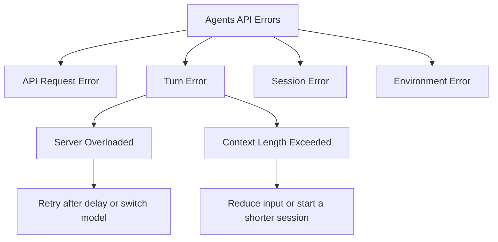

**TL;DR**

- Three issues reported in openai/codex in late November 2026 report client or connector behavior (as reported by users): token-budget context loss on ineligible models, task summaries listing commits GitHub cannot find, and chats missing after a WSL migration [1][2][9].
- OpenAI's Agents API sorts errors into four buckets and ties each to a recovery path [4].
- Rate limits recover via a Retry-After header, or exponential backoff with jitter when the header is absent [5]. For teams building their own harness, Braintrust names four span types and Pydantic AI's harness ToolBudgets caps tool calls [7][8].

OpenAI Codex errors rarely look like a crash when they hit mid-task; they look like a clean completion. Three issues reported in openai/codex between November 20 and 22, 2026, each describe a quiet failure: a token-budget overrun that silently discards a request, a connector task summary that lists commits GitHub cannot find, and a WSL migration that leaves chats missing [1][2][9]. Each reports success while losing your work. In our assessment, these are client and connector defects with concrete workarounds rather than shortcomings in the model itself, so the fixes sit within reach. This article gathers those workarounds into one recovery reference, mapped to OpenAI's own error taxonomy.

## Three Recently Reported OpenAI Codex Errors

Three issues filed in openai/codex between November 20 and 22, 2026, report client and connector behavior as their users describe it [1][2][9]. Whether the underlying defect sits in the client, the connector, or the model is a characterization the sources themselves do not make. A client-side defect has a repeatable fix, while a model defect would sit beyond your reach.

The first is silent context loss. Issue #63198 reports that enabling token_budget without the history/notes extension, on a model where supports_experimental_context is false (the reporter used gpt-6.2-astra), opens a new context window after a token-budget reminder; that window holds none of the user's prior messages. The agent replies with a generic acknowledgement and marks the turn complete while the task remains unfinished [1].

The second is a connector commit gap: the chatgpt-codex-connector bot posted task completion summaries—not formal PR reviews—on the GCV-Sleeper-Service repository listing commit SHAs that GitHub's API rejects with HTTP 422 (No commit found for SHA), with no matching published follow-up PR [2]. A summary that cites commits GitHub cannot find is worse than no summary at all.

The third involves a WSL migration on Windows: Codex Desktop's automatic migration left projects on the legacy WSL agent environment showing no chats despite intact, readable Windows transcripts [9]. The tracker lists issue #62735 as open as of 2026-11-25, and commenters describe multi-step manual recovery procedures [9].

Most of the evidence in this article comes from OpenAI's own materials (its issue tracker plus its Agents API and error-codes documentation), so treat the numbers that follow as vendor-reported.

The table below maps each reported issue to the symptom that signals it and the issue number that records it.

| Reported issue | Reported symptom | Issue |
| --- | --- | --- |
| Token budget context loss | New context window drops user messages after a token-budget reminder on an ineligible model [1] | #63198 |
| Connector commit gap | Task summary lists SHAs returning HTTP 422 with no matching follow-up PR [2] | #63197 |
| WSL migration chat gap | Automatic migration leaves projects showing no chats despite intact transcripts [9] | #62735 |

## How OpenAI's Agents API Classifies Errors

OpenAI's Agents API docs split failures into four categories: API request errors, turn errors, session errors, and environment errors [4]. Structured errors carry two fields that matter: error.code for programmatic branching, and error.message for human-facing explanation [4]. Branch on the code; display the message.

Turn errors—the ones Codex users feel most directly—matter the most. Two matter most: server_overloaded and context_length_exceeded. For an overloaded model (server_overloaded), OpenAI recommends retrying after a brief delay, or switching models for later turns. A context length problem may instead call for trimming the input or opening a new session with a condensed summary [4].

The taxonomy maps cleanly onto Codex's real failures. A token-budget context drop is a turn-level error that arrives as a silent success. A connector summary that cites commits GitHub cannot find is a turn that completed against state that did not exist. A WSL migration failure is an environment-level fault. Knowing which bucket a failure sits in decides the move: retry, repair state, or start fresh.



## Retry Patterns That Survive Rate Limits

OpenAI lists 503 (server overload) and model overload as temporary failures you can retry, while a 500 is an unexpected error that should prompt you to check your saved work before trying again [4].

Rate limits want different handling. For a 429 response, let the Retry-After header set the wait when the server sends one; otherwise back off exponentially with jitter while keeping the attempt count bounded [5]. Why jitter? It staggers concurrent clients so they no longer retry in lockstep and hammer the endpoint again.

```python
import random
import time

# RateLimited is the client exception raised on HTTP 429 (define it yourself).
def call_with_backoff(fn, attempts=5):
    for n in range(attempts):
        try:
            return fn()
        except RateLimited as exc:
            if n == attempts - 1:
                raise  # re-raise the final failure instead of making another call
            retry_after = getattr(exc, "retry_after", None)
            wait = retry_after if retry_after is not None else (2 ** n) + random.uniform(0, 1)
            time.sleep(wait)

```

Why cap the retries? Unbounded retries on a persistent 429 can hold a request for minutes, and your context (and your user) both wait. A small number of jittered attempts, then a surfaced error, beats a long silent pause.

> [!TIP]
> OpenAI's recovery ladder for server errors: check saved work, then retry after a brief delay [4]. Treat a persistent overload as a signal to switch models for later turns, not to keep retrying the same one [4].

## Capping Tools and Tracing Plans When Agents Drift

Braintrust's [agent observability](/posts/2026-08-07-production-agent-debugging-from-logs-to-root-cause/) guide names the wrong tool, the wrong arguments, and a drifted plan as agent-failure signals [7]. It lists four span types that an instrumented agent should record: tool-call spans, reasoning spans, state-transition spans, and memory-operation spans [7]. These spans apply to agents you build and instrument yourself with Braintrust SDKs or OpenTelemetry; we cannot trace the OpenAI-hosted Codex connector's internal tool-call spans from the outside. Can a Codex user trace them at all? No.

Tool budgets stop drift from compounding for teams running their own harness. Pydantic AI's pydantic-ai-harness package offers ToolBudgets, which caps per-tool and total tool calls within a run [8]. When a call would exceed budget, the harness answers the model with a refusal result that states which budget was hit and the current usage, and the run continues [8]. In our reading, this cap lives in the pydantic-ai-harness 0.x package rather than Pydantic AI core, which places it in reach for teams building their own agent wrapper but not for someone driving the hosted Codex connector.

The table below lists the four span types Braintrust names and what each records.

| Span type | What it records |
| --- | --- |
| Tool-call span | The tool that ran and the arguments it used |
| Reasoning span | The agent's planning and reasoning |
| State-transition span | How plan and memory shifted between turns |
| Memory-operation span | Reads and writes to memory stores |

For a team shipping its own agent, this decides whether you catch a wrong commit before it posts. A tool-call span shows the connector asserting a SHA, and validating that SHA against GitHub surfaces the 422 before it reaches a comment. A Codex end user cannot add those spans to the hosted connector, but can validate any commit a summary cites against the source of truth before trusting it.

Anthropic's agent guide adds a control that fits the same theme for teams running autonomous agents: include stopping conditions such as a maximum number of iterations, so a run has a bound [6].

## Recovering Token-Budget Context Loss Without a Restart

The token-budget context drop is the subtlest failure because it reports success: the agent sends a generic acknowledgement and marks the turn complete, yet its new context window held none of your request [1]. The work is not done; it is gone from view.

The failing configuration is straightforward: enabling token_budget directly—without the history/notes extension—on a model that does not expose experimental-context support [1]. Issue #63198's reporter ran gpt-6.2-astra, where supports_experimental_context is false; they report that context_management has no effect in that case [1]. The reporter's workaround is token_budget = false [1].

A commenter on the issue notes a second option for ineligible models: set use_history_notes_extension = true inside the token_budget config block, though they warn that the thread_hint backend returns 404 for some backends [1].

Detection has a signature: a generic acknowledgement arriving immediately after a token-budget reminder, rather than a task-specific answer. Recovery has two steps: rehydrate the user's intent from whatever external state survived, such as the plan file or the issue text, then turn token_budget off (or enable the notes extension) so the next reminder does not repeat the loss.



> [!WARNING]
> Do not trust a complete status that follows a token-budget reminder. Verify the agent actually did the work against the original request, not just that it said it did.


Token-budget context loss is a turn error that mimics success. On models without experimental-context support, turn token_budget off and treat a generic post-reminder acknowledgement as a failed turn; rehydrate intent from external state before proceeding.


## A Production Checklist for OpenAI Codex Errors

The patterns above compress into a checklist: run it before enabling a new configuration, while a run is active, and after an incident.

One symptom does not fit the reported failure issues, but it corrupts every metric that depends on them. The Codex desktop app reported a task as taking about 38 minutes when active work was roughly 8 minutes; the remaining half hour was idle approval wait, counted as execution time [3]. Separate active work from human-wait latency, and never trust a duration number until you have verified it.

Each row below names the stage, the check, and the failure it prevents. The checks are our recommendations (inferred from the issues above), not quotes from a single source.

| Stage | Check | Failure it prevents |
| --- | --- | --- |
| Pre-deployment | Leave token_budget off on models without experimental-context support | Silent context loss |
| Pre-deployment | Back up Windows chat history before a WSL migration | Chats missing after migration |
| Runtime | Validate commit SHAs against GitHub before trusting a summary | Summary citing commits GitHub cannot find |
| Runtime | Record tool-call, reasoning, state-transition, and memory spans | Wrong tool, wrong arguments, or a drifted plan |
| Runtime | Track active work separately from approval idle time | Inflated duration metrics |
| Post-incident | Feed failed traces back into the eval suite | The same failure shipping twice |

## Practical Takeaways

1. Turn token_budget off on models without experimental-context support, and treat a generic post-reminder acknowledgement as a failed turn.
2. Validate commit SHAs against GitHub's API before a connector posts a summary, and fall back to a draft when any commit returns 422.
3. For a 429, honor the Retry-After header when present; otherwise back off exponentially with jitter while capping the attempts [5].
4. Treat Braintrust's four span types and Pydantic AI's harness ToolBudgets as tools for your own agent, not for the hosted Codex connector [7][8].
5. Measure active work separately from approval idle time before trusting duration metrics.

## Conclusion

Treat the quiet failures as the real ones: a dropped window, a summary that cites commits GitHub cannot find, and chats missing after a migration all pass as clean until someone audits them. Fix them in order: turn the budget flag off on models that do not support the experimental context, validate connector output against the source of truth, and back up history before migrating. Whether the vendor folds these into the product or leaves them to the user decides whether you instrument before you trust. Either way, review the work yourself before believing any completed status.

## Frequently Asked Questions

### Why does Codex reply with a generic acknowledgement and mark a task complete when nothing finished?

This is token-budget context loss. Enabling token_budget without the history/notes extension, on a model where supports_experimental_context is false, drops the prior messages from the new context window after a token-budget reminder, so the agent no longer sees the unfinished request [1]. The reporter's workaround is token_budget = false; a commenter notes you can instead set use_history_notes_extension = true in the token_budget block, though the thread_hint backend returns 404 for some backends [1]. Rehydrate the user's intent from any state that survived before proceeding.

### Should I retry a 429 rate-limit error right away?

No. Honor the Retry-After header when present; if it is missing, use exponential backoff with jitter and cap the attempts [5].

### Would observability catch a connector listing a commit GitHub cannot find?

Only if you build the agent yourself. Teams instrumenting their own agent can record tool-call and state-transition spans [7]. We would also validate each cited commit against GitHub before it posts. A Codex end user cannot trace the OpenAI-hosted connector's internal spans; as a practical safeguard, we suggest validating any commit a summary cites before trusting it.

### Can I safely let Codex auto-migrate my Windows projects to WSL?

Issue #62735 is open as of 2026-11-25 and reports that the automatic migration left project lists showing no chats despite intact Windows history [9]. The report is a snapshot, not a guarantee the behavior is unchanged. Community comments describe multi-step manual recovery procedures [9]. Back up your chat history and verify the migration output before relying on it, then treat any 'no chats' symptom as a signal to check the Windows transcripts before switching platforms. For the full audit, run the checks in the production checklist section before and after any migration.

### How much of my task duration is actually idle approval wait?

One report, issue #63190, shows a task reported at roughly 38 minutes where only about 8 minutes were active work and about 30 minutes were approval wait, with the app counting total elapsed time as execution time [3]. You want separate metrics for active execution and human-wait latency, or your duration numbers overstate how much work the model did.

---

## Sources

| # | Publisher | Title | URL | Date | Type |
| --- | --- | --- | --- | --- | --- |
| 1 | GitHub (openai/codex) | "Issue #63198: token_budget without the history/notes extension drops active user request" | https://github.com/openai/codex/issues/63198 | 2026-11-22 | Technical |
| 2 | GitHub (openai/codex) | "Issue #63197: chatgpt-codex-connector posts task summaries listing commit SHAs GitHub cannot find" | https://github.com/openai/codex/issues/63197 | 2026-11-22 | Technical |
| 3 | GitHub (openai/codex) | "Issue #63190: Codex App task duration includes time waiting for user approval" | https://github.com/openai/codex/issues/63190 | 2026-11-22 | Technical |
| 4 | OpenAI Developers | "Errors and recovery | OpenAI API (Agents API)" | https://developers.openai.com/api/docs/guides/agents-api/errors | undated | Documentation |
| 5 | OpenAI Developers | "Error codes | OpenAI API" | https://developers.openai.com/api/docs/guides/error-codes | undated | Documentation |
| 6 | Anthropic | "Building effective agents" | https://www.anthropic.com/engineering/building-effective-agents | 2024-12 | Blog |
| 7 | Braintrust | "Agent observability: The complete guide for 2026" | https://www.braintrust.dev/articles/agent-observability-complete-guide-2026 | 2026-06-21 | Blog |
| 8 | Pydantic AI | "Tool Budgets" | https://pydantic.dev/docs/ai/harness/tool-budgets/ | undated | Documentation |
| 9 | GitHub (openai/codex) | "Issue #62735: [Windows][WSL] Automatic migration leaves projects with no chats despite intact Windows history" | https://github.com/openai/codex/issues/62735 | 2026-11-20 | Technical |

## Image Credits

- **Cover photo**: Image generated with gpt-5.4-image-2 (Agents' Codex AI illustration)
- **Figure 1**: Image generated with gpt-5.4-image-2 (Agents' Codex AI illustration)
